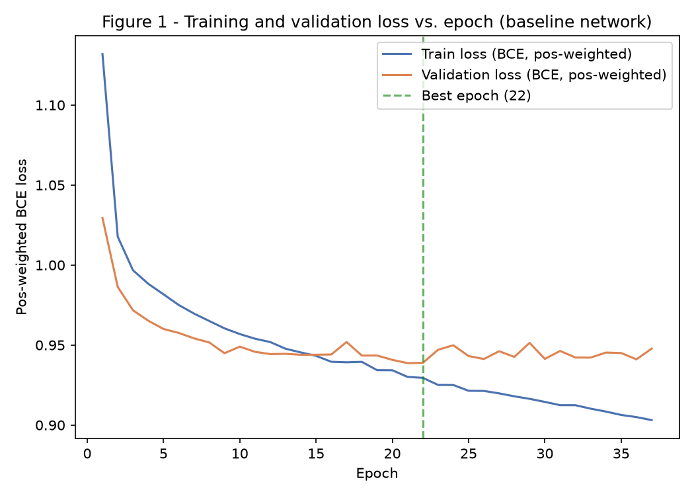
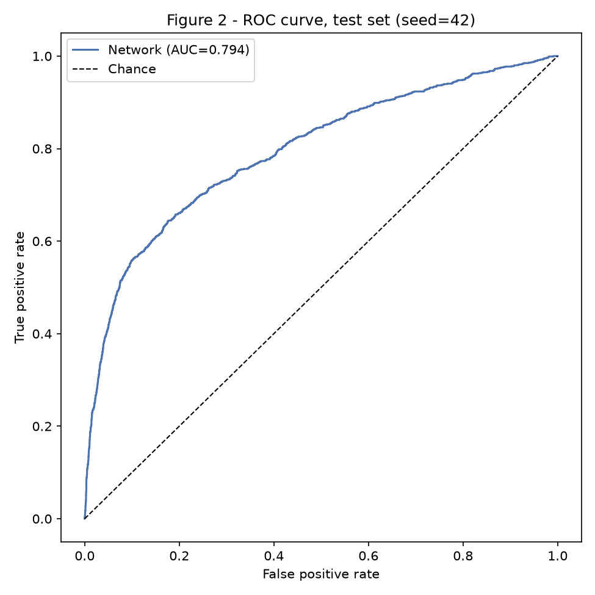
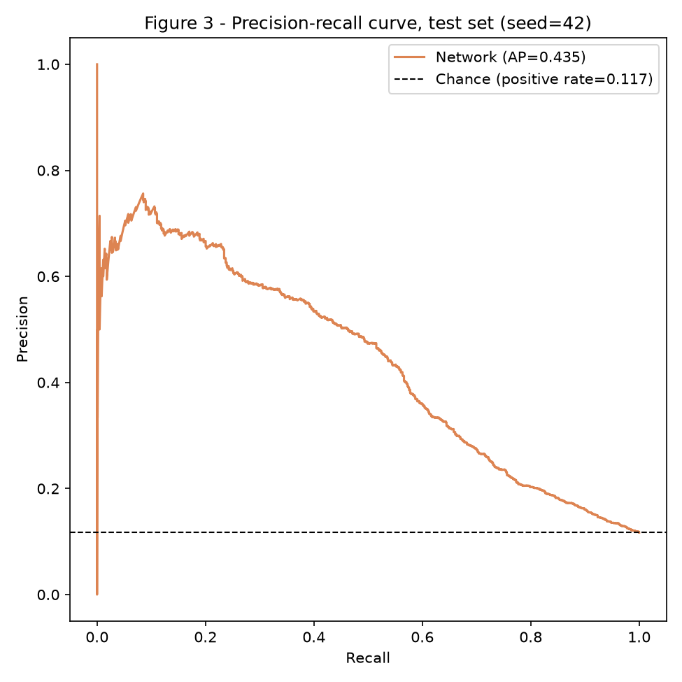

# Classification or Regression — Bank Marketing (Classification)

Same dataset, task and train/test split as the [Classification EDA](../eda/index.md), same seed (`random_state=42`) throughout. Its fitted preprocessing `Pipeline` (`code/bank_preprocessing.py`) is imported unchanged, carrying forward every one of its decisions: `duration` dropped as target leakage, `"unknown"` kept as its own category, the `pdays` sentinel handled with a missing-indicator, and the stratified 80/20 split.

The team also built the [regression track](../regression/index.md) of this same assignment, on the Seoul Bike Sharing dataset from the same EDA — both are submitted; this report covers classification.

Five scripts under `code/`, run in order from a clean clone:

``` shell
python3 -m venv env
source ./env/bin/activate
python3 -m pip install -r requirements.txt --upgrade
python3 code/classification_baselines.py      # Step 1
python3 code/classification_training.py       # Steps 2-3, Figure 1
python3 code/classification_search.py         # Step 4
python3 code/classification_test_eval.py      # Step 5, Figures 2-3 (touches the test set)
python3 code/classification_error_analysis.py # Step 6
```

`code/classification_common.py` and `code/classification_model.py` hold what every script shares: the inner train/validation split and metrics, and the `MLPClassifier` + early-stopping training loop, respectively.

## 0. Starting Point

- **Pipeline:** `bank_preprocessing.build_preprocessor()`, fit on the training fold only — unchanged from the EDA (no grading corrections were available for this dataset at the time of writing).
- **Main metric:** **PR-AUC** (average precision) — with an 11.7% positive rate, ROC-AUC and accuracy are both flattering (a model that never predicts "yes" still scores 88.3% accuracy and 0.5 ROC-AUC is the only floor that looks bad); PR-AUC is sensitive to exactly the class that is rare and that the bank cares about (will this client subscribe?).
- **Success criterion, fixed before training:** *network test PR-AUC at least 15% higher (relative) than Logistic Regression's test PR-AUC.* Logistic Regression, not the optional Random Forest, is the mandatory comparison point — Random Forest is reported for context only.
- **Internal validation split:** the EDA's 80/20 test split is untouched (**test: 9,043 rows**); its 80% training side (36,168 rows) is further split, stratified on `y`, into **30,742 training rows** and **5,426 validation rows**.

## 1. Baselines

Three models fit once on the inner training fold, class imbalance handled with `class_weight="balanced"` (the sklearn equivalent of the network's `pos_weight`, so every baseline and the network handle the 11.7% positive rate the same way: reweighting the loss/split criterion, not resampling the data):

``` python
--8<-- "code/classification_baselines.py"
```

| Baseline | Validation PR-AUC | ROC-AUC | Macro F1 |
|---|---|---|---|
| Dummy (most frequent) | 0.117 | 0.500 | 0.469 |
| **Logistic Regression** (required) | 0.415 | 0.774 | 0.617 |
| Random Forest (optional) | 0.460 | 0.812 | 0.679 |

The dummy baseline's PR-AUC (0.117) is, by construction, exactly the positive rate — the floor any real model must clear. Random Forest already beats Logistic Regression by a wide margin on validation, the first sign (before any network is trained) that this dataset rewards non-linear interactions among the categorical predictors — consistent with the EDA's own finding that `poutcome`, `month` and `job` each carry large, non-monotonic swings in subscription rate.

## 2. The Network

``` python
--8<-- "code/classification_model.py"
```

Baseline architecture for Steps 2-3: **51 → 32 → 16 → 1**, `ReLU` hidden activations, 1 linear **logit** output unit, **2,209 parameters**. Layer sizes are arguments, not hard-coded, so Step 4 can sweep them.

- **Widths / depth:** 32 then 16, 2 hidden layers — the same mild-taper, two-layer recipe as the regression track, for the same reason: the EDA's categorical drivers interact (e.g. `month`'s effect is itself confounded with contact volume, 1B), which a single wide layer can only approximate by brute force.
- **Activation:** `ReLU`, standard for tabular MLPs, no saturation issue with the standardized/one-hot input block.
- **Initialization:** PyTorch's default (Kaiming-uniform, matched to `ReLU`).
- **Output & loss:** 1 linear unit returning a **logit** (no sigmoid inside the model), trained with `BCEWithLogitsLoss` — its fused log-sigmoid is numerically stable where a separate `Sigmoid` + `BCELoss` can saturate and vanish-gradient on confident logits.
- **Imbalance handling:** `pos_weight = n_negative / n_positive = 7.549` on the training fold, inside the loss — every false negative on the rare "yes" class costs as much as 7.5 false positives on "no" during training, which is what lets the network find a usable decision boundary at all for an 88%/12% split.
- **Parameters vs. training rows:** 2,209 parameters for 30,742 training rows — **13.92 rows per parameter**, a considerably more comfortable ratio than the regression track's 4.38, since this dataset has far more rows relative to its (smaller, mostly one-hot) feature count.

## 3. Training

``` python
--8<-- "code/classification_training.py"
```

- **Optimizer:** Adam, same justification as the regression track (handles the mixed standardized/one-hot feature block without per-group tuning).
- **Learning rate:** `1e-3`.
- **Batch size:** 256 — larger than the regression track's 128, since there are roughly 5.5x more training rows and the positive class (even after `pos_weight`) needs enough examples per batch to produce a stable gradient.
- **Epochs:** capped at 200, **early stopping with patience 15** on **validation PR-AUC** (not loss — PR-AUC is the metric that matters for the imbalance, and the pos-weighted BCE loss is not monotonically related to it), best weights restored.



**Convergence and overfitting onset:** training loss falls smoothly throughout; validation loss tracks it closely through about **epoch 15**, then flattens and turns noisy while training loss keeps a slow, steady decline — the onset is milder and arrives much earlier here (epoch ~15 of 37) than in the regression track (epoch ~75 of 284), consistent with this network having a far more comfortable rows-per-parameter ratio. The best validation PR-AUC was reached at **epoch 22**.

## 4. Regularization and Hyperparameters

Same recipe as the regression track — dropout, weight decay, batch normalization against the Step 2-3 baseline, plus two widths, **8 configurations**, selected on **validation PR-AUC**:

``` python
--8<-- "code/classification_search.py"
```

| Configuration | Validation PR-AUC | ROC-AUC | Macro F1 | Best epoch |
|---|---|---|---|---|
| **+ dropout 0.2** | **0.4688** | 0.8076 | 0.6340 | 72 |
| Wider [64, 32] + dropout 0.2 + weight decay 1e-4 | 0.4657 | 0.8027 | 0.6467 | 22 |
| + batchnorm + dropout 0.2 | 0.4652 | 0.8066 | 0.6598 | 31 |
| + dropout 0.2 + weight decay 1e-4 | 0.4631 | 0.8063 | 0.6469 | 22 |
| Baseline [32, 16] (no reg.) | 0.4611 | 0.8015 | 0.6488 | 22 |
| + weight decay 1e-4 | 0.4586 | 0.8010 | 0.6527 | 22 |
| Wider [64, 32] (no reg.) | 0.4567 | 0.7938 | 0.6293 | 20 |
| + batchnorm | 0.4561 | 0.8082 | 0.6556 | 9 |

**This is the opposite finding from the regression track, and just as honest a result as that track's negative one.** There, every regularization technique hurt; here, **dropout helps** (0.4688 vs. 0.4611 for the unregularized baseline, +1.7% relative) and trains for over 3x longer before its best epoch (72 vs. 22) — exactly what dropout is supposed to do: slow convergence just enough to keep exploring past the point an unregularized network would already have locked in. The two tracks disagree because their actual overfitting risk differs: 13.92 rows/parameter here versus 4.38 there, and Figure 1 above shows the gap between train and validation loss opening earlier and more persistently here than the regression track's Figure 1 did, despite the far better data-to-parameter ratio — a sign that this task's signal-to-noise ratio (predicting a rare behavioral outcome from mostly weak categorical correlates) is intrinsically harder to fit cleanly than the regression track's smoother, physically-driven target. Weight decay and batch norm, on their own, are roughly neutral to mildly negative (consistent with the regression track), and widening the network without dropout actively hurts (0.4567, worse than the narrow baseline) — more capacity without a way to control it just overfits faster.

**Chosen configuration: `[32, 16]` + dropout 0.2** — carried into Step 5.

## 5. Test Evaluation

The test set is used **exactly once**, here. The winning Step 4 configuration is retrained from **3 seeds** (`42, 43, 44`), each with its own validation-chosen, F1-maximizing threshold (the same recipe applied to every baseline too, so precision/recall/F1 are compared fairly — PR-AUC and ROC-AUC do not depend on a threshold at all):

``` python
--8<-- "code/classification_test_eval.py"
```

| Model | Threshold | Test PR-AUC | ROC-AUC | Precision (yes) | Recall (yes) | F1 (yes) | Macro F1 |
|---|---|---|---|---|---|---|---|
| Dummy (most frequent) | 0.500 | 0.117 | 0.500 | 0.000 | 0.000 | 0.000 | 0.469 |
| Logistic Regression (required) | 0.644 | 0.409 | 0.772 | 0.453 | 0.440 | 0.447 | 0.687 |
| Random Forest (optional) | 0.556 | 0.443 | 0.799 | 0.410 | 0.539 | 0.466 | 0.691 |
| **Network (mean ± std, 3 seeds)** | ~0.69 | **0.435 ± 0.003** | 0.794 ± 0.001 | 0.472 ± 0.011 | 0.499 ± 0.012 | 0.485 ± 0.004 | **0.707 ± 0.002** |





**Success criterion:** *network test PR-AUC at least 15% higher (relative) than Logistic Regression's.* LogReg: 0.4091; network: 0.4352 — a **6.4% relative improvement. Criterion NOT met.** This is the honest negative result for this track (mirroring the regression track's honest negative result in Step 4, the other direction): the network is measurably better than the required linear baseline, and has the best macro F1 of any model here (0.707, ahead of Random Forest's 0.691), but the margin over Logistic Regression is real without being large, and the network's own test PR-AUC (0.435) sits slightly **below** the optional Random Forest baseline's (0.443) — the one case across both tracks where an ensemble of trees beats the hand-built network outright.

Figure 2's ROC curve (AUC 0.794) and Figure 3's PR curve (AP 0.435, well above the 0.117 chance line, peaking around 0.75 precision near 10% recall before falling off) both show a model with genuine, well-calibrated-looking discriminative power — this is not a near-random result, just a modest one relative to the 15% bar. The gap between macro F1 (where the network wins) and PR-AUC (where Random Forest edges ahead) says something specific: at its own chosen operating threshold, the network balances precision and recall on the "yes" class slightly better than the trees do, but Random Forest's probability ranking is marginally better calibrated *across every possible threshold* (what PR-AUC measures) — the kind of distinction that would matter if the bank later wants to change its calling budget (and hence its threshold) without retraining.

## 6. Error Analysis

``` python
--8<-- "code/classification_error_analysis.py"
```

**Error rate by subgroup**, for the three categorical features the EDA ranked as the strongest drivers of subscription rate (`poutcome`: 55.4 pp spread; `month`: 44.2 pp; `job`: 21.6 pp):

| Subgroup | n (test) | Error rate | Actual positive rate |
|---|---|---|---|
| month = mar | 86 | 46.5% | 57.0% |
| month = oct | 146 | 44.5% | 43.8% |
| month = sep | 128 | 43.8% | 50.8% |
| month = dec | 36 | 38.9% | 44.4% |
| **poutcome = success** | 306 | 33.3% | 65.0% |
| job = student | 180 | 32.8% | 27.8% |
| job = retired | 452 | 26.8% | 22.1% |

**The four worst months (mar, oct, sep, dec) are exactly the four thinnest months in the EDA's own cardinality table** (training counts of a few hundred each, versus May's 30.6% share of all contacts) — the EDA already flagged these as having "wide confidence intervals" on their subscription rate precisely because so few examples exist. The network inherits that same statistical thinness: it cannot learn a reliable month-specific pattern for `sep`/`oct`/`mar`/`dec` from a few hundred training examples apiece, so its errors concentrate exactly where the EDA predicted the *data* itself would be least informative — a direct validation of the EDA's own caution, now showing up as a modelling consequence rather than just a confidence-interval width.

`poutcome = success` is a different, more interesting failure mode: this is the single **strongest** individual predictor the EDA found (65% actual subscription rate here, vs. 9-16% for the other three levels), yet it has the third-highest error rate (33.3%). The ten most confident wrong predictions make the mechanism explicit:

| poutcome | month | job | actual | predicted proba |
|---|---|---|---|---|
| success | dec | services | 0 (no) | 0.991 |
| success | sep | retired | 0 (no) | 0.990 |
| success | sep | admin. | 0 (no) | 0.988 |
| success | feb | student | 0 (no) | 0.987 |
| success | feb | student | 0 (no) | 0.985 |
| success | sep | admin. | 0 (no) | 0.985 |
| success | jun | student | 0 (no) | 0.984 |

**Nine of the ten most confident wrong predictions are false positives on `poutcome = success` clients who still said no.** The network (correctly) learned that `poutcome = success` is an extremely strong positive signal — but "extremely strong" is still only 65% in the data, not 100%, and the network's confidence (consistently > 0.98) overshoots what that signal actually guarantees. This is a calibration problem on the single most important feature, not a case of the network missing the signal.

**Permutation importance** (PR-AUC drop when a feature is shuffled, mean over 10 permutations):

| Feature | PR-AUC drop |
|---|---|
| `day` | 0.0577 |
| `poutcome_success` | 0.0520 |
| `contact_unknown` | 0.0424 |
| `month_feb` | 0.0171 |
| `previous` | 0.0135 |
| `poutcome_failure` | 0.0122 |

`poutcome_success` and `contact_unknown` ranking highly **matches the EDA directly**: `poutcome` was its single strongest categorical driver (55.4 pp spread), and `contact = "unknown"` was flagged as having its own distinct subscription rate (4.07% vs. 14.78% when known) tied to a recording-practice artifact concentrated in the first 30% of the file by row order. **`day` ranking first is the one genuinely concerning finding here, not a confirmation.** The EDA explicitly described `day` as reflecting "call scheduling rather than a smooth quantity" and flagged a broader row-order drift linked to the data's collection period (no year column; `contact = unknown` is concentrated early in the file). `day`'s outsized importance is plausible evidence that the network is partly exploiting that same scheduling/collection-period confound rather than a stable, causal relationship between calendar day and a client's propensity to subscribe — a risk the EDA warned about for exactly this kind of feature, and one future work should test directly (Step 7).

## 7. Conclusion

**Was the network worthwhile?** Partially. It clears the required Logistic Regression baseline on every single metric reported (PR-AUC, ROC-AUC, macro F1), and has the best macro F1 of the four models compared — but the 15% relative PR-AUC improvement set in Step 0 was not met (6.4% achieved), and on the metric that mattered most for Step 0's own reasoning (PR-AUC, chosen for the class imbalance), the simpler, un-tuned Random Forest baseline is marginally ahead. For this dataset, a from-scratch 2-hidden-layer MLP is a real but modest improvement over a linear model, not a clear win over a well-understood tree ensemble.

**Limitations:** (1) the `day` permutation-importance finding (Step 6) suggests part of the network's predictive power may rest on a data-collection artifact (scheduling/row-order drift) the EDA flagged, rather than a genuinely causal signal — this limits how much the reported test performance should be trusted to transfer to a future, differently-scheduled campaign. (2) The thin-month subgroups (`mar`, `sep`, `oct`, `dec`) are both the worst-performing and the least-tested (dozens to ~150 test rows each) — the error-rate estimates for those months carry real sampling uncertainty on top of the genuine difficulty. (3) The `poutcome = success` overconfidence (Step 6) means the network's probability outputs are not well calibrated on its single strongest feature, which matters if the bank wants to use the raw probability (not just the yes/no call) to prioritize which clients to call first.

**Affected stakeholders:** the marketing/call-center team deciding whom to contact. The calibration issue on `poutcome = success` is directly actionable: if call-center capacity is limited and clients are prioritized by predicted probability, the current network would over-rank "previously successful" clients relative to their true 65% conversion rate, potentially crowding out other, better-calibrated-but-lower-raw-probability leads from other segments.

**Future work:** (1) directly test the `day`/row-order-drift hypothesis by re-running Step 6's permutation importance with `day` and `contact` removed, to see whether the remaining features alone still clear the success criterion, or whether performance was partly inflated by the confound. (2) Probability calibration (e.g. Platt scaling or isotonic regression) fit on the validation set, specifically targeting the `poutcome = success` overconfidence. (3) A log-odds or hierarchical treatment of `month`, pooling the thin months (`mar`, `sep`, `oct`, `dec`) toward a shared estimate instead of letting the network fit each in isolation from only a few hundred examples.

## Results summary

| # | Summary | Value |
|---|---|---|
| 1 | Dataset, task, target and main metric | UCI Bank Marketing; binary classification; target `y` (subscribed, 11.7% positive); main metric PR-AUC |
| 2 | Train · validation · test (rows) | 30,742 · 5,426 · 9,043 |
| 3 | Best baseline and its test metric | Random Forest (optional), test PR-AUC 0.443 (required linear baseline, Logistic Regression: test PR-AUC 0.409) |
| 4 | Chosen network: layers × units, parameters, regularization | 2 hidden layers, 32×16 units (51→32→16→1), 2,209 parameters; dropout 0.2 (the one technique that helped — Step 4) |
| 5 | Optimizer, learning rate, batch, stopping epoch | Adam, lr=1e-3, batch=256, stopped at epoch 72 (seed 42; patience 15 past the best epoch) |
| 6 | Network's main metric on test (mean ± std, 3 seeds) | PR-AUC 0.435 ± 0.003 (ROC-AUC 0.794 ± 0.001, macro F1 0.707 ± 0.002) |
| 7 | Success criterion met? | No — 6.4% relative PR-AUC improvement over Logistic Regression (criterion: ≥ 15%) |
| 8 | Subgroup with the largest error and its value | month = mar (n=86): 46.5% error rate, vs. 12.0% overall test error rate |
