<!--
  Every number below comes from python scripts/regression_eda.py and is stored in
  docs/projects/eda-regression/outputs/numbers.json (or the CSV named next to it).
-->

# Regression EDA - UCI Seoul Bike Sharing Demand

> All statistics after 1D are computed on the training set only. No model is trained anywhere in this report.

---

## 0. Proposal

| Item | Value |
|---|---|
| Dataset | UCI Seoul Bike Sharing Demand: `SeoulBikeData.csv` |
| URL | <https://archive.ics.uci.edu/dataset/560/seoul+bike+sharing+demand> |
| Size (original) | **8,760 rows x 14 columns** (13 input columns + target) |
| Target | `rented_bike_count`: number of public bikes rented in Seoul in that hour (count, continuous for regression) |
| Features (original) | **9 numerical**, **3 categorical**, **1 date** |
| Approval status | **Approved** by the instructor. |

**Motivation.** Seoul's public bike system must have bikes available at the right hour. Predicting hourly demand from the time of day, the calendar and the weather is a regression problem that has a direct operational use (rebalancing, staffing). The data are real, cover a full year (2017-12-01 to 2018-11-30) and mix numerical weather readings with categorical calendar features.

**First risk.** Consecutive hours are strongly dependent. A row-level random split would put 10 h of a day in train and 11 h of the same day in test, which inflates test scores. We split by whole days (1D).

---

## 1. Initial inspection

### 1A. Data dictionary

**Source.** Seoul Metropolitan Government public bike data (Seoul Open Data Plaza), joined with weather data from the Korea Meteorological Administration, published on UCI by Sathishkumar V E and Yongyun Cho (2020). **One row = one hour** in Seoul. There are 365 days x 24 hours = 8,760 rows, exactly 24 rows per day, with no duplicated `(date, hour)` pair.

| Column (renamed) | Original header | Type | Unit / levels | Role |
|---|---|---|---|---|
| `date` | Date | date (dd/mm/yyyy) | 2017-12-01 to 2018-11-30 | used for the grouped split and to derive `day_of_week`; not a model input |
| `rented_bike_count` | Rented Bike Count | integer count | bikes per hour | **target** |
| `hour` | Hour | integer, cyclical | 0-23 h | numerical |
| `temperature` | Temperature(°C) | float | °C | numerical |
| `humidity` | Humidity(%) | integer | % relative humidity | numerical |
| `wind_speed` | Wind speed (m/s) | float | m/s | numerical |
| `visibility` | Visibility (10m) | integer | units of 10 m (2000 = 20 km, the sensor ceiling) | numerical |
| `dew_point` | Dew point temperature(°C) | float | °C | numerical |
| `solar_radiation` | Solar Radiation (MJ/m2) | float | MJ/m² | numerical |
| `rainfall` | Rainfall(mm) | float | mm | numerical |
| `snowfall` | Snowfall (cm) | float | cm | numerical |
| `seasons` | Seasons | categorical | Winter, Spring, Summer, Autumn | categorical |
| `holiday` | Holiday | categorical | Holiday, No Holiday | categorical |
| `functioning_day` | Functioning Day | categorical | Yes, No | categorical (leaks the target, see 1B) |
| `day_of_week` | *derived from `date`* | categorical | Mon ... Sun | categorical |

Full table with dtypes and cardinalities: `outputs/data_dictionary.csv`.

### 1B. Data quality

**Missing values.** **0 `NaN`** in all 14 columns (0.00% everywhere). The file does have **disguised missing values**: `humidity == 0` in **17 hours** (0.19%), all on five days in May 2018 (2018-05-19, 05-21, 05-22, 05-27, 05-28). 0% relative humidity is physically impossible in Seoul, so these are sensor faults. They are treated as missing in 4A.

**Duplicates.** 0 duplicated rows and 0 duplicated `(date, hour)` pairs.

**Consistency checks** (`outputs/consistency_checks.csv`):

| Check | Rows |
|---|---|
| hour outside 0-23 | 0 |
| humidity outside 0-100 | 0 |
| humidity == 0 (sensor fault) | 17 |
| negative wind / visibility / solar / rain / snow | 0 |
| dew_point > temperature (physically impossible) | 0 |
| solar_radiation > 0 between 22 h and 4 h | 0 |
| season label inconsistent with the month | 0 |
| snowfall > 0 with temperature > 5 °C | 14 |
| visibility at the 2000 (20 km) ceiling | 2,245 (25.63%) |

The 14 "snow above 5 °C" rows are plausible if `snowfall` records snow on the ground rather than new snow. They are kept. The 2,245 rows at visibility = 2000 are a **sensor ceiling** (censoring), not an error, so they are kept too.

**Target leakage: `functioning_day`.** In the **295 hours** (3.37%) with `functioning_day == "No"`, the target is **always 0**. These are exactly the 295 zero-target rows (0 zeros remain on functioning hours). Those hours fall on 13 days (12 of them closed for all 24 hours). They record times when the rental system was closed, not demand. The column is a deterministic rule, not a predictor (`outputs/functioning_day_vs_target.csv`).

**Columns and rows to drop.**

- **The 295 non-functioning rows are dropped.** At prediction time, operators know whether the system is open, so the model only has to predict demand for open hours. After dropping, `functioning_day` is constant ("Yes"), so it is dropped too. **8,465 rows remain.**
- `date` is not a model input. It is used to group the split (1D) and to derive `day_of_week`. The year is not useful because the data cover a single year.
- `dew_point` is redundant (3A). It is dropped inside the pipeline (4C).
- There is no identifier column.

### 1C. Target

Target on the training set (n = 6,761, after 1D). The values on the full retained data are almost identical: mean 729.16, median 542.0, skewness 1.140.

| Statistic | Value |
|---|---|
| mean / median | **731.07 / 547.0** bikes/h |
| std | 640.69 |
| min / Q1 / Q3 / P99 / max | 2 / 214 / 1,087 / 2,522.6 / 3,418 |
| skewness / excess kurtosis | **1.125 / 0.752** |
| skewness after `sqrt` | **0.352** |
| skewness after `log1p` | -0.749 |

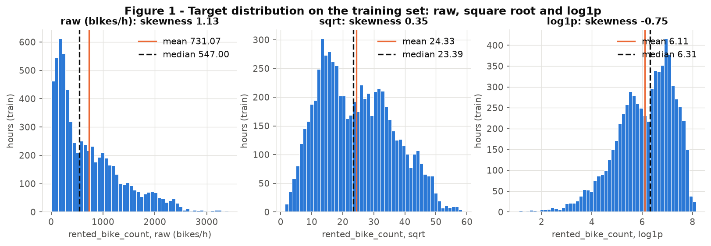

**Figure 1.** The raw target is right-skewed (skewness 1.125, mean 731 > median 547). Most hours have a few hundred rentals, and a long tail reaches 3,418. `log1p` overcorrects (skewness -0.749): it stretches the night hours with only 2-50 rentals into a left tail. **Conclusion: train on `sqrt(y)` (skewness 0.352, the closest to 0), invert with a square when predicting, and report errors in bikes/h.**

### 1D. Train/test split

- **Method:** `StratifiedGroupKFold(n_splits=5, shuffle=True, random_state=42)`; the first fold is the test set (`code/bike_preprocessing.py:split`).
- **Groups = `date`:** all 24 hours of a day are on the same side. **0 days** appear in both sets (282 train days, 71 test days). This prevents the hour-to-hour leakage named as the first risk in Stage 0.
- **Strata = `seasons`:** each season is in both sets in the same proportion. A purely temporal split (last 20% of the year) would put almost only autumn in the test set and no winter, so a model would be tested on a season it never saw.
- **Sizes:** **train 6,761 rows, test 1,704 rows (20.13%).** The target is similar in both: mean 731.07 vs 721.55, median 547.0 vs 531.5.

| Season | train rows (%) | test rows (%) | train mean target | test mean target |
|---|---|---|---|---|
| Winter | 1,728 (25.56%) | 432 (25.35%) | 223.0 | 235.8 |
| Spring | 1,728 (25.56%) | 432 (25.35%) | 759.2 | 694.6 |
| Summer | 1,752 (25.91%) | 456 (26.76%) | 1,026.1 | 1,064.7 |
| Autumn | 1,553 (22.97%) | 384 (22.54%) | 932.3 | 890.9 |

The split is made before any preprocessing. From here on, every statistic is learned on the 6,761 training rows only. Row membership: `outputs/split_indices.csv`.

---

## 2. Univariate analysis (training set, n = 6,761)

### 2A. Numerical features

Descriptive table (`outputs/numerical_summary_train.csv`; IQR outliers = values outside Q1 - 1.5 IQR and Q3 + 1.5 IQR):

| Feature | Unit | mean | std | min | median | P99 | max | skewness | % zeros | % IQR outliers |
|---|---|---|---|---|---|---|---|---|---|---|
| hour | h | 11.51 | 6.92 | 0 | 12 | 23 | 23 | -0.00 | 4.16 | 0.00 |
| temperature | °C | 12.56 | 12.24 | -17.8 | 12.9 | 35.14 | 39.4 | -0.16 | 0.27 | 0.00 |
| humidity | % | 57.91 | 20.32 | 0 | 57 | 97 | 98 | 0.09 | 0.19 | 0.00 |
| wind_speed | m/s | 1.73 | 1.04 | 0 | 1.5 | 4.7 | 7.4 | 0.91 | 0.96 | 1.85 |
| visibility | 10 m | 1,442.19 | 612.12 | 27 | 1,722 | 2,000 | 2,000 | -0.72 | 0.00 | 0.00 |
| dew_point | °C | 3.71 | 13.39 | -30.6 | 4.5 | 24.8 | 27.2 | -0.32 | 0.67 | 0.00 |
| solar_radiation | MJ/m² | 0.58 | 0.88 | 0 | 0.01 | 3.16 | 3.52 | 1.48 | 49.24 | 7.22 |
| rainfall | mm | 0.14 | 1.15 | 0 | 0 | 4.0 | 35.0 | **15.32** | **94.54** | 5.46 |
| snowfall | cm | 0.07 | 0.41 | 0 | 0 | 2.2 | 8.8 | **9.47** | **94.82** | 5.18 |

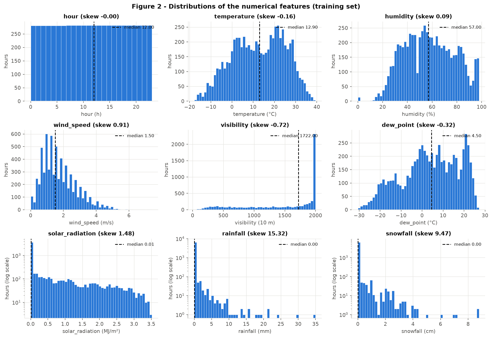

**Figure 2.** The features fall into four shapes:
- **Uniform:** `hour` is exactly uniform (one row per hour per day).
- **Bimodal, near-symmetric:** `temperature` (modes near 2 °C and 22 °C, winter and summer), `humidity` and `dew_point`. Their skewness is between -0.32 and 0.09.
- **Right-skewed:** `wind_speed` (0.91). `solar_radiation` is zero-inflated (49.24% zeros: the night) with skewness 1.48.
- **Zero-inflated with extreme tails:** `rainfall` (94.54% zeros, skewness 15.32, max 35 mm) and `snowfall` (94.82% zeros, skewness 9.47, max 8.8 cm).

`visibility` is left-skewed (-0.72) because of the **ceiling at 2000**: 26.25% of the training hours sit exactly on it. The humidity bar at 0 is the sensor fault from 1B. **Conclusion: the treatment depends on the shape (scale only / log1p / clip + log1p), and `hour` needs a cyclical encoding, not a skew fix.**

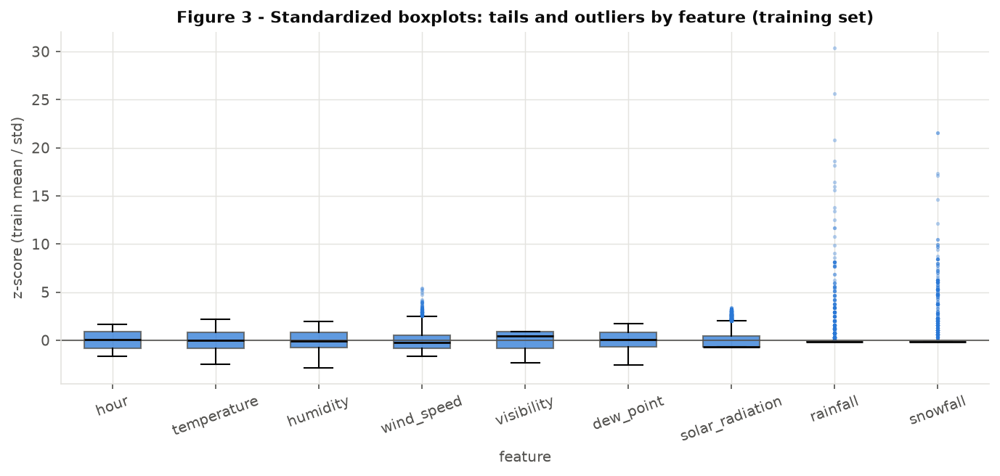

**Figure 3.** On a common z-scale, only `rainfall` (up to ~30 standard deviations) and `snowfall` (~21 SD) have extreme outliers. Their IQR "outliers" (5.46% and 5.18%) are simply all the non-zero hours. The `wind_speed` (1.85%) and `solar_radiation` (7.22%) tails are moderate and physically valid. **Conclusion: clip only `rainfall` and `snowfall` (4A). The IQR rule would flag every rainy hour, so we do not remove rows.**

### 2B. Categorical features

| Feature | Levels | Frequencies (training set) | Rare (< 5%)? |
|---|---|---|---|
| `seasons` | 4 | Summer 1,752 (25.91%), Winter 1,728 (25.56%), Spring 1,728 (25.56%), Autumn 1,553 (22.97%) | no |
| `holiday` | 2 | No Holiday 6,425 (95.03%), **Holiday 336 (4.97%)** | **yes**: only 14 holiday days in train |
| `day_of_week` | 7 | Sun 15.26%, Wed 14.91%, Thu 14.91%, Mon 14.20%, Tue 14.20%, Fri 13.49%, Sat 13.03% | no |
| `functioning_day` (full data, before dropping) | 2 | Yes 8,465 (96.63%), No 295 (3.37%) | yes, and dropped (leakage, 1B) |

Files: `outputs/categorical_frequencies.csv`, `outputs/categorical_cardinality.csv`.

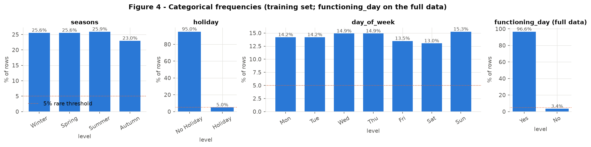

**Figure 4.** All categorical features have **low cardinality** (2 to 7 levels), so there is no high-cardinality problem. Seasons and weekdays are balanced. The only rare level is `Holiday` (4.97%, 14 days), right at the 5% threshold. **Conclusion: one-hot encoding is cheap here (13 columns). The `Holiday` effect will be estimated from only 14 days, so it is a risk (5B).**

---

## 3. Bivariate and multivariate analysis (training set)

### 3A. Numerical x numerical

**Method: Spearman as the primary coefficient, Pearson for comparison.** Rainfall and snowfall are 95% zeros with extreme tails, and the target is skewed. Pearson is dominated by a few extreme hours there, while Spearman measures monotonic association on ranks. The gap shows it: rainfall vs target is Pearson -0.118 but Spearman -0.275.

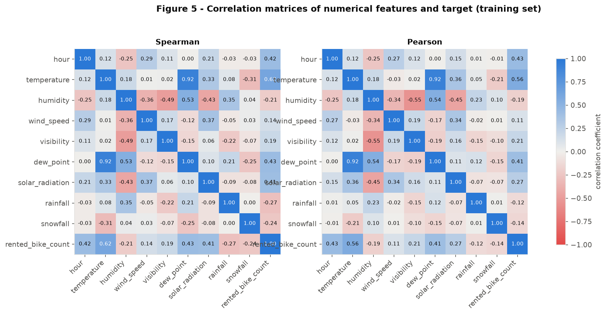

**Figure 5.** The **most correlated pair is `temperature` - `dew_point`: Spearman 0.918 (Pearson 0.919).** The next pairs are much weaker:
- `humidity` - `visibility`: Spearman -0.491
- `humidity` - `dew_point`: 0.533
- `humidity` - `solar_radiation`: -0.432

Against the target, Spearman (Pearson in brackets):

| Feature | vs target |
|---|---|
| temperature | 0.617 (0.565) |
| dew_point | 0.426 (0.409) |
| hour | 0.423 (0.432) |
| solar_radiation | 0.413 (0.274) |
| rainfall | -0.275 (-0.118) |
| snowfall | -0.241 (-0.144) |
| humidity | -0.205 (-0.186) |
| visibility | 0.190 (0.209) |
| wind_speed | 0.141 (0.114) |

**Conclusion: `temperature` and `dew_point` are redundant.** Dew point is a physical function of temperature and humidity: a linear fit on those two explains **R² = 0.9916** of its variance. We drop `dew_point` and keep the two more interpretable inputs.

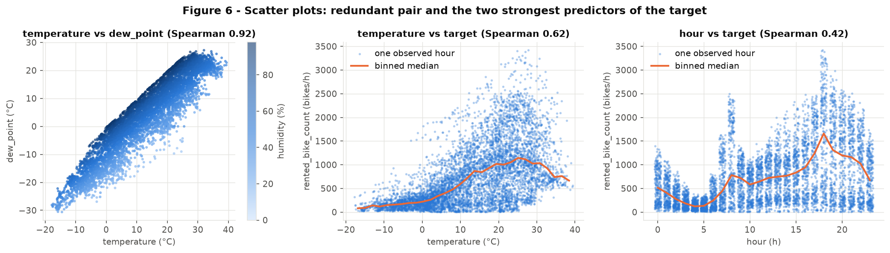

**Figure 6.**
- **Left:** `dew_point` follows `temperature` along a tight band whose offset is set by humidity, which confirms the redundancy.
- **Middle:** demand rises with temperature up to about 25 °C (binned median ~1,100 bikes/h) and then *falls* towards 35-40 °C. The relation is not monotonic.
- **Right:** `hour` has two peaks (8 h and 18 h) and a trough at 4-5 h, which no linear term on `hour` can represent.

**Conclusion: the main signals are non-linear and cyclical. That supports a neural network with a sin/cos encoding of `hour` over a linear model.**

Precipitation acts like a switch rather than a gradient. In the 5.46% of training hours with `rainfall > 0`, the median demand is **86** bikes/h, against **587** in dry hours. In the 5.18% of hours with `snowfall > 0` it is **149** against **588**.

### 3B. Categorical x target

Target by category (training set; `outputs/categorical_target_stats_train.csv`):

| Feature | Level: mean / median (bikes/h) |
|---|---|
| seasons | Winter 223.0 / 197.5; Spring 759.2 / 610.5; Summer 1,026.1 / 886.5; Autumn 932.3 / 857.0 |
| holiday | No Holiday 744.0 / 568.0; Holiday 483.2 / 240.0 |
| day_of_week | Mon 744.8 / 573.0; Tue 721.1 / 533.0; Wed 775.0 / 608.5; Thu 682.9 / 455.5; Fri 802.3 / 640.0; Sat 765.1 / 589.0; Sun 639.8 / 422.5 |

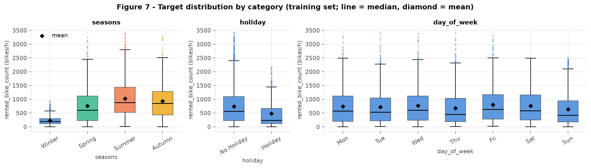

**Figure 7.**
- **Season:** the strongest categorical effect. The winter median (197.5) is about 4.5 times lower than summer (886.5), and winter's spread is also much narrower.
- **Holidays:** the median is less than half that of normal days (240 vs 568).
- **Day of week:** medians range only from 422.5 (Sun) to 640.0 (Fri), with large overlap.

**Conclusion: `seasons` and `holiday` shift the target level. `day_of_week` alone shifts it little, but it changes the daily *shape* (Figure 8).**

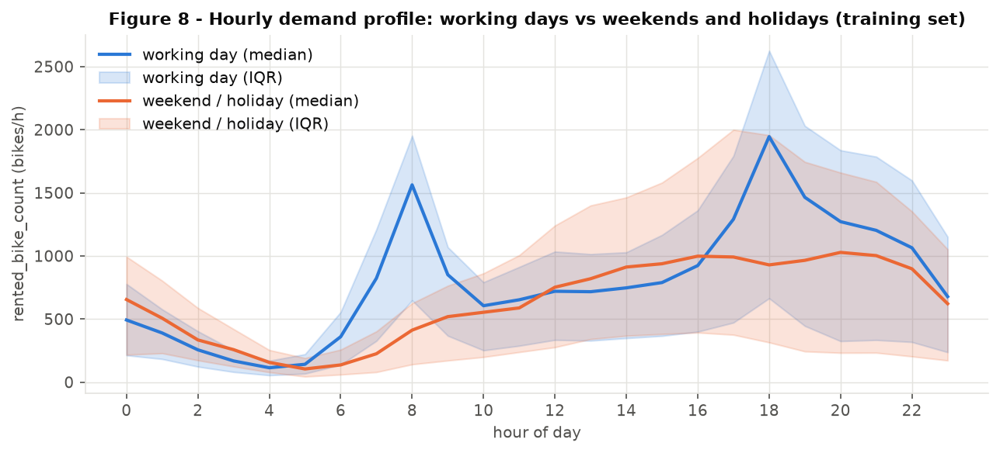

**Figure 8.** On working days (4,560 training hours), demand has a commuter shape:
- a morning peak at **8 h (median 1,564)**;
- the daily maximum at **18 h (median 1,946)**.

On weekends and holidays (2,201 hours), there is no morning peak (8 h median 412). Demand rises slowly to an evening plateau, with a maximum at 20 h (median 1,028). **Conclusion: hour and day type interact. The model must be able to combine `hour_sin/cos` with `day_of_week` and `holiday`, which a network with hidden layers can learn and a purely additive model cannot.**

### 3C. Numerical x categorical (grouped boxplots by season)

Median (IQR) by season, training set (`outputs/grouped_box_stats_train.csv`):

| Feature | Winter | Spring | Summer | Autumn |
|---|---|---|---|---|
| temperature (°C) | -2.4 (8.1) | 13.0 (10.3) | 26.8 (6.6) | 12.6 (11.7) |
| humidity (%) | 46 (28) | 58 (36) | 65 (27) | 57 (31) |
| solar_radiation (MJ/m²) | 0.00 (0.42) | 0.06 (1.28) | 0.16 (1.36) | 0.00 (0.93) |
| visibility (10 m) | 1,812.5 (1,054.8) | 1,325 (1,309.3) | 1,798 (916) | 1,904 (815) |

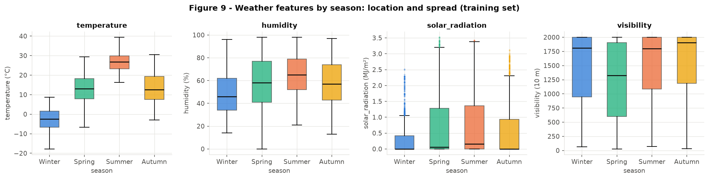

**Figure 9.**
- **Location:** temperature separates the seasons in the expected order. Summer is the warmest (median 26.8 °C) and the most stable (IQR 6.6), while spring and autumn have similar medians (13.0 vs 12.6 °C) but the widest spread (IQR 10.3 and 11.7), because they are transition seasons.
- **Humidity:** grows from winter (46%) to summer (65%).
- **Solar radiation:** its spread triples from winter (IQR 0.42) to summer (1.36).
- **Visibility:** spring has the lowest median visibility (13.25 km) and the largest spread, consistent with spring dust and haze.

**Conclusion: season is partly a proxy for weather, but spring and autumn overlap in temperature, so season carries information beyond temperature (Figure 10).**

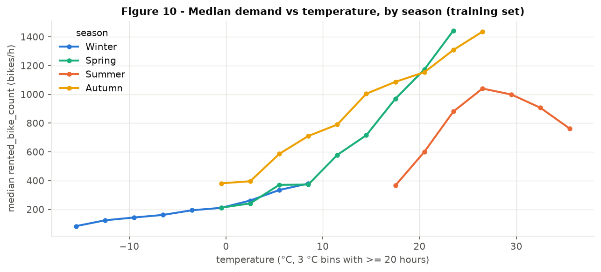

**Figure 10.** At the same temperature, demand differs by season. Around 20 °C, the median is about 1,150 bikes/h in spring and autumn but about 600 in summer. In summer, demand peaks near 26.5 °C (about 1,040) and then falls to about 760 at 35.5 °C (heat and the humid monsoon). **Conclusion: the temperature effect depends on season, another interaction to leave to the hidden layers. Keep `seasons` even though it correlates with temperature.**

---

## 4. Preprocessing

The destination is a **neural network**, which needs dense, finite inputs on comparable scales. Each choice below cites the finding that motivates it. Every statistic is fitted on the training set only (4C).

### 4A. Strategies

#### Missing values

| Finding | Strategy |
|---|---|
| 0 `NaN` in all columns (1B) | `SimpleImputer` in every branch (median for numerical features, most frequent for categorical). It changes nothing on this data but guards against `NaN` in future data. |
| `humidity == 0` in 17 hours, a physically impossible sensor fault (1B, Figure 2) | Mask 0 to `NaN`, then impute with the **training median of the valid readings (57%)**. Affected: **13 training rows and 4 test rows.** |
| `functioning_day == "No"` means target = 0 by rule (1B) | Not a missing-value case: these 295 rows are removed before the split. In deployment, closed hours are predicted as 0 by rule. |

#### Outliers

| Finding | Strategy |
|---|---|
| `rainfall` (skewness 15.32, max 35 mm) and `snowfall` (skewness 9.47, max 8.8 cm) have extreme tails (Figure 3), and demand is already near its floor once it rains or snows (3A: median 86 and 149 bikes/h) | **Cap at the training P99**: rainfall at **4.0 mm**, snowfall at **2.2 cm** (`QuantileClipper`), then `log1p`. Training rows affected: 60 (rainfall), 56 (snowfall), **115 rows with at least one clipped value (1.70%)**. Test rows: 16, 41, **57 (3.35%)**. **0 rows removed.** |
| `wind_speed`, `solar_radiation`: moderate tails, physically valid (Figure 3) | Not clipped; `log1p` compresses them. |
| `visibility` at the 2000 ceiling (26.25% of training rows) | Kept as is. The ceiling is censoring, not an outlier, and standardization keeps the ceiling as a single value. |

The test clip rate is higher (3.35% vs 1.70%) because snowy days happened to fall more often into the test days (41 clipped snowfall hours from 1,704 test rows). The bounds stay those learned on train.

#### Categorical encoding

| Finding | Strategy |
|---|---|
| `seasons` (4), `holiday` (2) and `day_of_week` (7) have low cardinality and no natural order usable by a network (2B) | **One-hot** encoding, giving 13 columns. |
| Categories that appear only in the test set | `OneHotEncoder(handle_unknown="ignore")`: an unseen level becomes an all-zero row instead of an error. None occurs in this test set (checked: 0 test-only levels for all three features). |
| `hour` is cyclical: 23 h and 0 h are neighbours, and demand has two daily peaks (Figure 6, 8) | Encode as **`hour_sin`, `hour_cos`** = sin/cos(2π·hour/24). |

#### Scaling

| Finding (2A) | Strategy |
|---|---|
| `temperature`, `visibility` near-symmetric or bounded | `StandardScaler` |
| `humidity` near-symmetric, with the sensor zeros | mask 0 → median impute → `StandardScaler` |
| `wind_speed` (skewness 0.91), `solar_radiation` (1.48) right-skewed | `log1p` → `StandardScaler`; skewness drops to **0.02** and **1.05** |
| `rainfall`, `snowfall` zero-inflated, extreme tails | P99 clip → `log1p` → `StandardScaler`; skewness drops from 15.32 to **5.59** and from 9.47 to **5.20** |
| `dew_point` redundant with temperature (R² 0.9916, 3A) | dropped |
| target skewness 1.125 (1C) | not in the X pipeline: train on `sqrt(y)` (skewness 0.352) |

The remaining skewness of rainfall and snowfall is a property of the 95% zero mass, which no monotonic transform removes. After the transform, all non-zero values lie in a narrow range, which is what matters for gradient-based training.

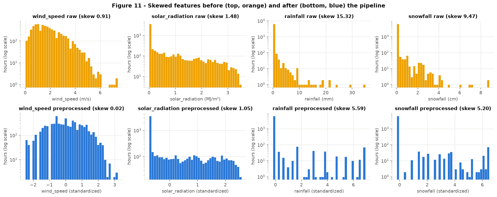

**Figure 11.** The pipeline turns `wind_speed` into an almost symmetric feature (0.91 → 0.02). For `solar_radiation`, `rainfall` and `snowfall` it compresses the tail into a few standard deviations while keeping the zero spike (dry or night hours) as a separate value. **Conclusion: no input to the network can reach the ~30 SD values seen in Figure 3.**

### 4B. Dimensionality reduction

The input is the 22 preprocessed training features (6,761 rows; the full training set, no subsample needed). Points are colored by `log1p(rented_bike_count)`, with the color range clipped to P2-P98 for contrast.

#### PCA

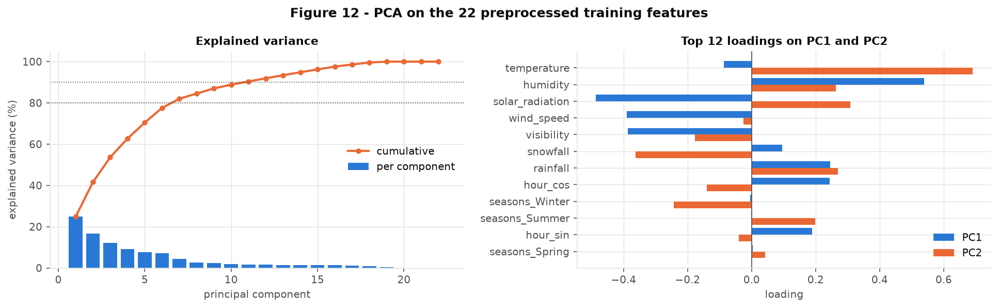

**Figure 12.** **PC1 explains 24.87%, PC2 16.73%, PC1 + PC2 = 41.60%.** 7 components reach 80%, 11 reach 90%, and 15 reach 95%. The rank is 19, not 22: each one-hot group sums to 1, so 3 columns are linearly dependent.

- **PC1 (dry and sunny vs humid and overcast):** humidity +0.54, solar_radiation -0.49, wind_speed -0.39, visibility -0.39, rainfall +0.25. Its correlation with log1p(target) is **-0.449**: humid, dark, still hours have low demand.
- **PC2 (warm season vs cold):** temperature +0.69, snowfall -0.36, solar_radiation +0.31, rainfall +0.27, humidity +0.26, seasons_Winter -0.24, seasons_Summer +0.20. Its correlation with log1p(target) is **+0.382**.
- The one-hot columns have near-zero loadings on PC1 and PC2. A 0/1 column has variance at most 0.25, against 1.0 for each standardized numerical feature, so PCA is dominated by the weather variables.

**Conclusion: the linear structure is spread over many directions (2 PCs = 41.60%). In Figure 13 (left), demand is highest in the upper-left region (dry, sunny, warm). It is lowest at the upper right (high PC1: humid, rainy hours) and at the bottom (low PC2: winter), with gradual transitions and no sharp boundary.**

#### t-SNE

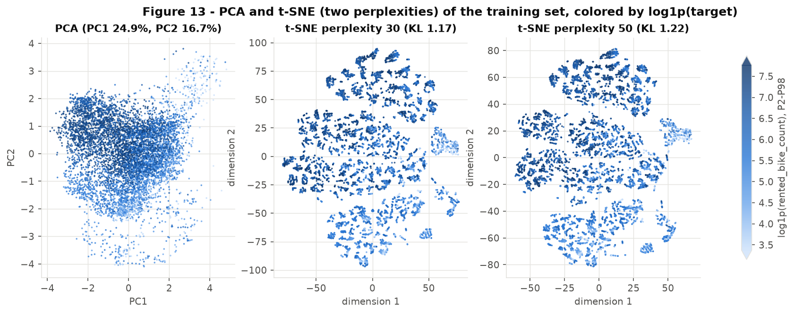

**Figure 13.** t-SNE with **perplexity 30** (final KL divergence 1.173) and **perplexity 50** (KL 1.218):
- Both show four large horizontal bands (one per season, Figure 15) plus a smaller group at the right edge, which is mostly wet hours.
- Inside each band, points form short curved strands: consecutive hours of the same day with similar weather.
- Perplexity 50 gives a smoother, more global arrangement than 30, but the same groups.
- The low-demand (light) points concentrate in the bottom band (winter) and in the right-edge group (wet hours).

**Conclusion: unlike PCA, t-SNE separates discrete regimes. Distances between bands and band sizes have no direct meaning in t-SNE.**

#### UMAP

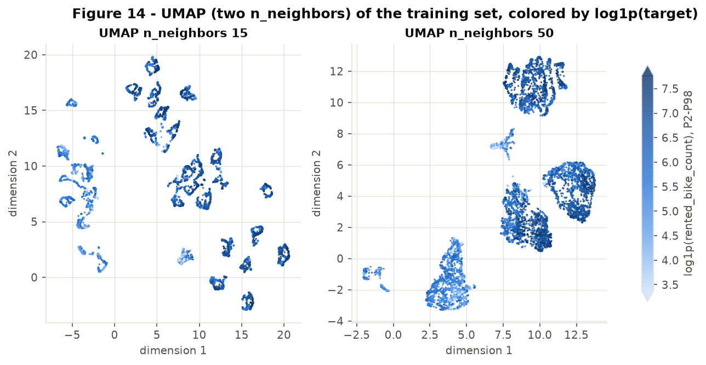

**Figure 14.** UMAP with **n_neighbors = 15** and **n_neighbors = 50** (min_dist 0.1):
- **n = 15** gives many small islands of similar hours.
- **n = 50** merges them into a few large groups, which is a more global view.
- Two small groups have the lowest demand, with low values clustered inside them: one is made of rainy hours, the other of snowy hours. This matches 3A (median 86 and 149 bikes/h versus about 587 when dry).

**Conclusion: UMAP isolates the precipitation regime as its own group. Distances between groups and their sizes are not interpretable.**

#### What t-SNE and UMAP reveal relative to PCA

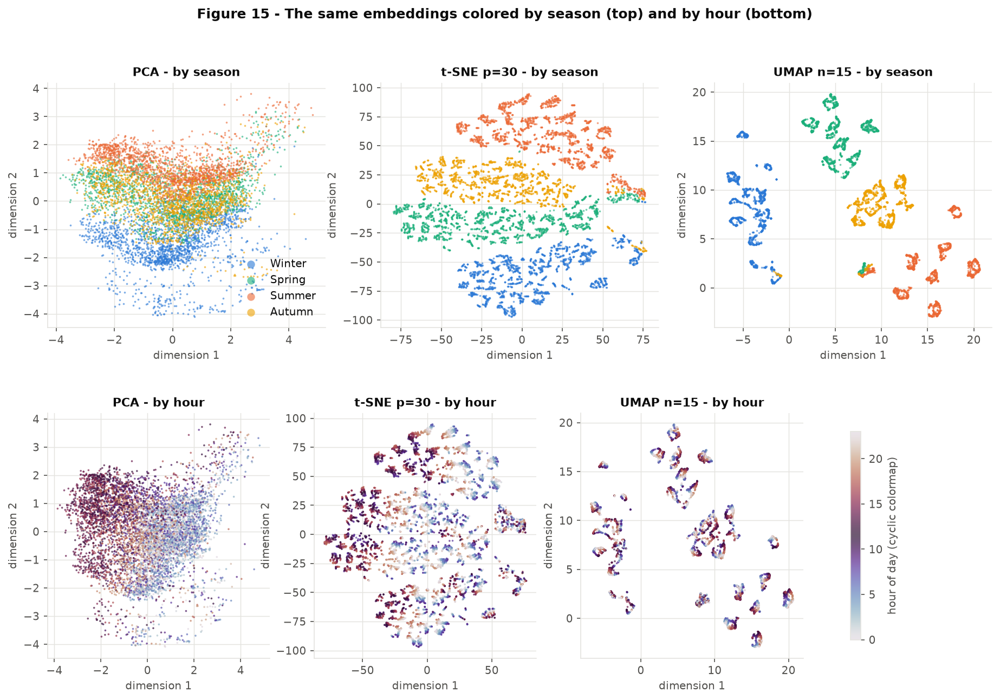

**Figure 15.**
- **Coloring by season (top row)** explains the large groups of t-SNE and UMAP: each is one season. PCA only shows a gradient from winter (bottom) to summer (top). The local methods separate the seasons because two rows in different seasons differ by √2 in the one-hot columns, which dominates small neighborhoods. Note that this separation partly reflects our encoding, not only the data.
- **Coloring by hour (bottom row)** shows the strands inside each group are ordered by hour of day (the sin/cos encoding makes a continuous loop).

**Conclusion: the data are organized by season → precipitation → hour-of-day trajectory. The target varies smoothly along those trajectories rather than forming separate clusters, as expected for a regression target. A network must learn those non-linear, interacting effects, and no 2-D projection makes the target linearly separable.**

Coordinates of all embeddings: `outputs/embeddings_train.csv`.

### 4C. Pipeline

Importable file: [`code/bike_preprocessing.py`](https://github.com/Thaisrs165/exploratory_data_analysis/blob/main/code/bike_preprocessing.py). It defines `load_data()` (drops the 295 non-functioning rows), `split()` (1D) and `build_preprocessor()`: a `Pipeline` that wraps one `ColumnTransformer`, with five branches:

| Branch | Columns | Steps |
|---|---|---|
| `cyclical` | hour | most-frequent impute → sin/cos |
| `standard` | temperature, visibility | median impute → `StandardScaler` |
| `sensor_zero` | humidity | 0 → `NaN` → median impute → `StandardScaler` |
| `skewed` | wind_speed, solar_radiation | median impute → `log1p` → `StandardScaler` |
| `heavy` | rainfall, snowfall | median impute → P99 `QuantileClipper` → `log1p` → `StandardScaler` |
| `categorical` | seasons, holiday, day_of_week | most-frequent impute → `OneHotEncoder(handle_unknown="ignore")` |
| *(dropped)* | date, dew_point | `remainder="drop"` |

```python
import sys; sys.path.insert(0, "code")
from bike_preprocessing import load_data, split, build_preprocessor
X, y = load_data()
X_train, X_test, y_train, y_test = split(X, y)
pre = build_preprocessor().fit(X_train)           # fitted on the training set only
Z_train, Z_test = pre.transform(X_train), pre.transform(X_test)
```

**Checks (output of `python code/bike_preprocessing.py`):**

- Input shapes: train 6,761 x 13, test 1,704 x 13. The 13 columns are `date` plus the 12 listed in the table above.
- **Output shapes: train 6,761 x 22, test 1,704 x 22.**
- **`NaN` after the pipeline: 0 in train, 0 in test.**
- Clip bounds (train P99): rainfall 4.0 mm, snowfall 2.2 cm.
- **22 feature names:** `hour_sin`, `hour_cos`, `temperature`, `visibility`, `humidity`, `wind_speed`, `solar_radiation`, `rainfall`, `snowfall`, `seasons_Autumn`, `seasons_Spring`, `seasons_Summer`, `seasons_Winter`, `holiday_Holiday`, `holiday_No Holiday`, `day_of_week_Fri`, `day_of_week_Mon`, `day_of_week_Sat`, `day_of_week_Sun`, `day_of_week_Thu`, `day_of_week_Tue`, `day_of_week_Wed` (`outputs/feature_names.csv`).

---

## 5. Synthesis

### 5A. Main findings

1. **`functioning_day` leaks the target.** All 295 closed hours have 0 rentals. They are removed, which leaves 8,465 rows (1B).
2. **The target is right-skewed** (skewness 1.125). `sqrt` brings it to 0.352, better than `log1p` (-0.749) (Figure 1).
3. **Demand is driven by temperature (Spearman 0.617) and hour (0.423), both non-linearly.** Temperature has a summer peak near 26 °C, and hour has two commuter peaks on working days (Figures 6, 8, 10).
4. **Precipitation switches demand off:** median 86 bikes/h in rain and 149 in snow, against about 587 dry (3A, Figure 14).
5. **Interactions matter:** hour x day type (Figure 8) and temperature x season (Figure 10).
6. **`dew_point` is redundant** with temperature and humidity (Spearman 0.918; R² 0.9916) and is dropped (Figure 5).
7. **`rainfall` and `snowfall` are about 95% zeros with extreme tails.** They are capped at the training P99 and log-transformed (Figures 2, 3, 11).
8. **Low-dimensional structure:** season → precipitation → hour trajectories. PCA needs 7 components for 80% of the variance (Figures 12-15).

### 5B. Modelling risks and handling plan

| # | Risk | Evidence | Plan |
|---|---|---|---|
| 1 | **Temporal dependence** between hours of a day | 24 rows per day, smooth hour trajectories (Figure 15) | Keep the split grouped by day. For validation and tuning, use `GroupKFold` on `date` inside the training set, never a row-level random K-fold. |
| 2 | **Skewed target** and heteroscedasticity: winter has a much narrower spread than summer | Figure 1, Figure 7 | Train on `sqrt(y)` (`TransformedTargetRegressor`). Report RMSE and MAE in bikes/h, plus MAE per season. |
| 3 | **Few holidays** (14 training days, 4.97%) | 2B | Check residuals on holiday hours separately. If they are poor, merge `holiday` into a "weekend/holiday" day type as in Figure 8. |
| 4 | **Only one year** of data: each calendar period is seen once | 1A | Do not add `month` or year trend features that the test set would extrapolate. Treat results as valid for this year's climate only. |
| 5 | **Sensor artifacts**: 17 zero-humidity hours and a visibility ceiling (26.25%) | 1B, 2A | Humidity zeros are imputed (4A). The visibility ceiling is kept; a model can learn it as one value. |
| 6 | **Snowy days unevenly split** between the sets (3.35% of test rows clipped vs 1.70% of train rows) | 4A | Report test error on snowy hours separately; do not re-split to "fix" it. |
| 7 | **Deployment rule for closed hours** | 1B | Predict 0 when `functioning_day == "No"` before calling the model. |

### 5C. Summary table

| # | Item | Value |
|---|---|---|
| 1 | Dataset, task and target | UCI Seoul Bike Sharing Demand (`SeoulBikeData.csv`). **Regression.** Target `rented_bike_count`: bikes rented per hour. |
| 2 | Instances x features (numerical / categorical) | Original: 8,760 x 13 input columns (9 numerical, 3 categorical, 1 date) + target. Retained: 8,465 rows; 8 numerical (dew_point dropped) + 3 categorical (`seasons`, `holiday`, derived `day_of_week`). |
| 3 | Column with the most missing values and its percentage | No `NaN` (0.00% everywhere). Disguised missing: `humidity == 0`, 17 rows (0.19%). |
| 4 | Dropped columns and reasons | `functioning_day` (target leakage, constant after removing its 295 rows); `date` (used for the split and `day_of_week` only); `dew_point` (redundant, R² 0.9916 from temperature + humidity). |
| 5 | Target mean / median | Retained data: **729.16 / 542.0** bikes/h; training set: 731.07 / 547.0 (skewness 1.125). |
| 6 | Training and test sizes | **Train 6,761 rows (282 days); test 1,704 rows (71 days, 20.13%).** `StratifiedGroupKFold` grouped by date, stratified by season, `random_state=42`. |
| 7 | Most correlated numerical pair and correlation | `temperature - dew_point`: **Spearman 0.918** (Pearson 0.919), training set. |
| 8 | Rows affected by the outlier strategy | Train P99 cap of rainfall (4.0 mm) and snowfall (2.2 cm): **115 training rows (1.70%)** and **57 test rows (3.35%)**. 0 rows removed. (17 humidity sensor zeros imputed separately.) |
| 9 | Variance explained by PC1 + PC2 | **41.60%** (PC1 24.87% + PC2 16.73%), on the 22 preprocessed training features. |
| 10 | Train / test shapes after preprocessing | **Train 6,761 x 22; test 1,704 x 22.** 0 `NaN` in both. |

---

## Appendix. Reproducibility

From a clean clone (Python 3.9+):

```
pip install -r requirements.txt
python scripts/regression_download_data.py   # optional: the CSV is committed in data/raw/
python code/bike_preprocessing.py            # pipeline checks (4C)
python scripts/regression_eda.py             # all figures, tables and outputs/numbers.json
```

- Data: `data/raw/SeoulBikeData.csv`. The SHA-256 after CRLF → LF is `0ceeae88d0f6486da38bf57a9a58f5f78d17e3ce36bc6836c6bf8e9ac13fa8cc`, checked by `load_data()`. Raw download hashes: `data/raw/regression_download_log.json`.
- `random_state=42` for the split, PCA, t-SNE and UMAP.
- Last generated with Python 3.12.11, pandas 2.3.3, numpy 2.5.4, scikit-learn 1.9.1, umap-learn 0.5.12, matplotlib 3.11.2. t-SNE and UMAP coordinates may differ slightly across library versions or platforms. The figures' qualitative structure does not.
