<!--
  GENERATED FILE - do not edit docs/projects/eda/index.md by hand.
  Stages 0-3 are copied unchanged from docs/projects/eda/part1_draft.md (python scripts/part1_eda.py).
  Stages 4-5 come from scripts/templates/part2_template.md.
  Regenerate with: python scripts/part2_eda.py
  Every number below is substituted from values computed on data/raw/bank-full.csv.
-->

# Classification EDA - UCI Bank Marketing

> **Status: PENDING INSTRUCTOR APPROVAL.** The repository contains no record of instructor approval for this dataset. Approval is a prerequisite, so the proposal and the whole EDA below are provisional and must not be read as approved or final until approval is documented.
>
> Structure: stages 0-3 (Part 1) and stages 4-5 (Part 2). No model is trained anywhere in this report.

---

## 0. Proposal

| Item | Value |
|---|---|
| Dataset | UCI Bank Marketing, older full version: `bank-full.csv` |
| URL | <https://archive.ics.uci.edu/dataset/222/bank%2Bmarketing> |
| Size (original) | **45,211 rows x 17 columns** (16 input features + target) |
| Target | `y`: did the client subscribe to a term deposit? (`yes` / `no`, binary) |
| Features (original) | **7 numerical**, **9 categorical** (verified from the data, see 1A) |
| Features (after excluding `duration`) | **6 numerical**, **9 categorical** = 15 predictors |
| Approval status | **Pending.** No approval evidence exists in the repository. |

**Motivation.** Direct-marketing calls are expensive, and only 11.70% of the contacted clients in this dataset subscribed. A classifier that ranks clients by their chance of subscribing *before* a call is made could help the bank prioritise calls. The dataset is real (a Portuguese bank, May 2008 to November 2010), well documented, and has a mix of numerical and categorical features and a clear binary target, so it fits a classification EDA.

**First risk.** The target is imbalanced (11.70% `yes`, ratio 7.55 : 1), and the strongest single input, `duration`, is target leakage: it is only known after the call. We exclude it (see 1B), so realistic predictive signal will be weaker than published benchmarks that use it. A second risk is that the file is chronological and the subscription rate drifts strongly over time (1B).

---

## 1. Initial inspection

### 1A. Data dictionary

**Source.** UCI Machine Learning Repository, *Bank Marketing* (id 222), created by Paulo Cortez (Univ. Minho) and Sergio Moro (ISCTE-IUL), CC BY 4.0. Citation: S. Moro, R. Laureano and P. Cortez, *Using Data Mining for Bank Direct Marketing: An Application of the CRISP-DM Methodology*, ESM'2011, pp. 117-121.

**Download steps** (reproduced by `scripts/part1_download_data.py`):

1. Download `https://archive.ics.uci.edu/static/public/222/bank+marketing.zip` (the download link on the UCI page above).
2. The archive contains two nested zips: `bank.zip` (older version) and `bank-additional.zip` (newer version). Only `bank.zip` is used.
3. Extract `bank-full.csv` and `bank-names.txt` from `bank.zip` to `data/raw/`. The file is `;`-separated with quoted strings and a header row.
4. `bank-additional-names.txt` is also extracted, **only as documentation**: it holds UCI's official note on `duration` leakage (quoted in 1B). No `bank-additional` data is used.
5. Recorded: download time 2026-10-13T21:56:18+00:00 (UTC); `bank-full.csv` is 4,610,348 bytes, SHA-256 `d1513ec63b385506f7cfce9f2c5caa9fe99e7ba4e8c3fa264b3aaf0f849ed32d` (see `data/raw/part1_download_log.json`).

**What a row is.** One row is one client contacted in a direct-marketing phone campaign, with the attributes of their **last contact** in the current campaign. The file has 45,211 rows ordered by date (May 2008 to November 2010). UCI notes that a client often needed more than one contact; `campaign` counts them.

**Schema check.** Read with `pandas.read_csv(sep=";")`: 45,211 rows x 17 columns. Columns with an integer dtype (`int64`) are the numerical features (7). Columns with an `object` dtype other than `y` are the categorical features (9). This matches the expected 7 + 9 + target. The script asserts this, so it fails if the file changes.

| column      | meaning                                                                                        | role        | pandas dtype   | unit       | observed values / range                                                                                                                                      | Part 1 status      |
|:------------|:-----------------------------------------------------------------------------------------------|:------------|:---------------|:-----------|:-------------------------------------------------------------------------------------------------------------------------------------------------------------|:-------------------|
| `age`       | Client age                                                                                     | numerical   | int64          | years      | 18 to 95                                                                                                                                                     | retained           |
| `job`       | Type of job                                                                                    | categorical | object         | -          | `admin.`, `blue-collar`, `entrepreneur`, `housemaid`, `management`, `retired`, `self-employed`, `services`, `student`, `technician`, `unemployed`, `unknown` | retained           |
| `marital`   | Marital status (`divorced` = divorced or widowed)                                              | categorical | object         | -          | `divorced`, `married`, `single`                                                                                                                              | retained           |
| `education` | Education level                                                                                | categorical | object         | -          | `primary`, `secondary`, `tertiary`, `unknown`                                                                                                                | retained           |
| `default`   | Has credit in default?                                                                         | categorical | object         | -          | `no`, `yes`                                                                                                                                                  | retained           |
| `balance`   | Average yearly balance                                                                         | numerical   | int64          | euros      | -8,019 to 102,127                                                                                                                                            | retained           |
| `housing`   | Has housing loan?                                                                              | categorical | object         | -          | `no`, `yes`                                                                                                                                                  | retained           |
| `loan`      | Has personal loan?                                                                             | categorical | object         | -          | `no`, `yes`                                                                                                                                                  | retained           |
| `contact`   | Contact communication type (last contact, current campaign)                                    | categorical | object         | -          | `cellular`, `telephone`, `unknown`                                                                                                                           | retained           |
| `day`       | Day of month of the last contact                                                               | numerical   | int64          | day (1-31) | 1 to 31                                                                                                                                                      | retained           |
| `month`     | Month of year of the last contact                                                              | categorical | object         | -          | `jan`, `feb`, `mar`, `apr`, `may`, `jun`, `jul`, `aug`, `sep`, `oct`, `nov`, `dec`                                                                           | retained           |
| `duration`  | Duration of the last contact                                                                   | numerical   | int64          | seconds    | 0 to 4,918                                                                                                                                                   | excluded (leakage) |
| `campaign`  | Contacts performed during this campaign for this client, incl. the last one                    | numerical   | int64          | count      | 1 to 63                                                                                                                                                      | retained           |
| `pdays`     | Days since the client was last contacted in a previous campaign; -1 = not previously contacted | numerical   | int64          | days       | -1 to 871                                                                                                                                                    | retained           |
| `previous`  | Contacts performed before this campaign for this client                                        | numerical   | int64          | count      | 0 to 275                                                                                                                                                     | retained           |
| `poutcome`  | Outcome of the previous marketing campaign                                                     | categorical | object         | -          | `failure`, `other`, `success`, `unknown`                                                                                                                     | retained           |
| `y`         | Target: has the client subscribed to a term deposit?                                           | target      | object         | -          | `no`, `yes`                                                                                                                                                  | target             |

Notes: `day` and `month` record the date of the last contact. There is no year column, even though the data spans 2008-2010. `day` is kept numerical, following UCI, but it is a calendar position rather than a quantity.

### 1B. Data quality

**Missing values.** There are 0 `NaN` values in the whole file. Missing information is instead coded as the literal level `"unknown"` in `job`, `education`, `contact`, `poutcome`.

| column      |   NaN count |   NaN % |   "unknown" count |   "unknown" % |
|:------------|------------:|--------:|------------------:|--------------:|
| `age`       |           0 |    0.00 |                 0 |          0.00 |
| `job`       |           0 |    0.00 |               288 |          0.64 |
| `marital`   |           0 |    0.00 |                 0 |          0.00 |
| `education` |           0 |    0.00 |              1857 |          4.11 |
| `default`   |           0 |    0.00 |                 0 |          0.00 |
| `balance`   |           0 |    0.00 |                 0 |          0.00 |
| `housing`   |           0 |    0.00 |                 0 |          0.00 |
| `loan`      |           0 |    0.00 |                 0 |          0.00 |
| `contact`   |           0 |    0.00 |             13020 |         28.80 |
| `day`       |           0 |    0.00 |                 0 |          0.00 |
| `month`     |           0 |    0.00 |                 0 |          0.00 |
| `duration`  |           0 |    0.00 |                 0 |          0.00 |
| `campaign`  |           0 |    0.00 |                 0 |          0.00 |
| `pdays`     |           0 |    0.00 |                 0 |          0.00 |
| `previous`  |           0 |    0.00 |                 0 |          0.00 |
| `poutcome`  |           0 |    0.00 |             36959 |         81.75 |
| `y`         |           0 |    0.00 |                 0 |          0.00 |

- `"unknown"` counts on the full data: `job` 288 (0.64%), `education` 1,857 (4.11%), `contact` 13,020 (28.80%), `poutcome` 36,959 (81.75%). 37,369 rows (82.65%) have at least one `"unknown"`. Excluding `poutcome`, the figure is 14,304 rows (31.64%). Dropping such rows is therefore not an option.
- **Decision: keep `"unknown"` as its own category.** The data supports this. (i) For `poutcome`, `"unknown"` is structural: it almost exactly marks "not previously contacted" (see the `pdays` section). (ii) For `contact`, `"unknown"` is a recording-practice artifact: the first 12,657 rows in file (time) order are all `"unknown"`, and 97.21% of all `contact = "unknown"` rows fall in the first 30% of the file. (iii) `"unknown"` levels have their own subscription rates (for `contact`: 4.07% vs 14.78% when known). This means the values are not missing completely at random, and imputing them with the mode would erase signal.

**Duplicates.** There are 0 exact duplicate rows among all 17 columns. After `duration` is excluded, 16 rows duplicate an earlier row (31 rows involved, in 15 groups). None of these groups has conflicting labels (0 groups with different `y`). **Decision: keep them.** They differed only by call duration, so they are most likely different contacts with identical profiles rather than copy errors, and they are a negligible share of the data.

**`pdays = -1` sentinel.** UCI documents `-1` as "client was not previously contacted". It is not an impossible value but a code, and the data confirms this:

- 36,954 rows (81.74%) have `pdays = -1`. Exactly the same rows have `previous = 0` (36,954 rows; 0 mismatches).
- No other negative value and no `pdays = 0` exist (0 and 0 rows). Real values run from 1 to 871 days.
- Treating `-1` as a number is misleading. The mean of `pdays` is 40.20 with the sentinel and 224.58 among previously contacted clients only.
- Cross-tab with `poutcome`:

| pdays group   |   failure |   other |   success |   unknown |
|:--------------|----------:|--------:|----------:|----------:|
| pdays = -1    |         0 |       0 |         0 |     36954 |
| pdays >= 1    |      4901 |    1840 |      1511 |         5 |

- Subscription rate: 9.16% for never-contacted clients vs 23.07% for previously contacted ones. The sentinel is informative, so the "not previously contacted" information must be preserved in preprocessing (for example, a binary flag plus a `pdays` value that is masked or neutral for those clients).

**Impossible, inconsistent and implausible values** (full data):

| check                                               |   rows | interpretation                                                        | action                  |
|:----------------------------------------------------|-------:|:----------------------------------------------------------------------|:------------------------|
| age < 18 or > 100                                   |      0 | impossible for a bank client contact list                             | none                    |
| age > 90                                            |      7 | plausible but extreme                                                 | keep                    |
| day outside 1-31                                    |      0 | impossible                                                            | none                    |
| day exceeds days in its month (e.g. 31 apr, 30 feb) |      0 | impossible calendar date                                              | none                    |
| campaign < 1 (must include the last contact)        |      0 | impossible by definition                                              | none                    |
| previous < 0                                        |      0 | impossible                                                            | none                    |
| pdays < -1, or pdays = 0                            |      0 | impossible / undefined code                                           | none                    |
| pdays = -1 while previous > 0 (or the reverse)      |      0 | inconsistent                                                          | none                    |
| poutcome = unknown while previous > 0               |      5 | inconsistent: a previous contact exists but its outcome is unrecorded | keep; treat as category |
| poutcome known while previous = 0                   |      0 | inconsistent                                                          | none                    |
| balance < 0                                         |   3766 | valid: overdrawn account (balance is not bounded at 0)                | keep                    |
| duration = 0 s                                      |      3 | consistent with no conversation; all have y = no                      | moot: duration excluded |
| job = student and age > 40                          |     10 | implausible but possible                                              | keep                    |
| job = retired and age < 40                          |     25 | implausible but possible (early/disability retirement)                | keep                    |

- No impossible values were found. The only true inconsistency is 5 rows with `previous > 0` but `poutcome = "unknown"`. These are kept, because the category already represents "unrecorded".
- `balance < 0` in 3,766 rows (8.33%) is **not** an error: the average balance of an overdrawn account can be negative.

**Outliers.** These are quantified with the 1.5 x IQR rule on the training set in 2A (Figure 3). **Decision: no outliers are removed in Part 1.** Extreme `balance`, `campaign` and `previous` values are plausible, and removing them would change the population. Part 2 should prefer robust or monotone transforms (see Handoff).

**Identifiers and constants.** There is no ID column. The highest unique-value ratio is `balance` with 7,168 distinct values (0.159 of rows), which is a measurement, not an identifier. There are 0 constant columns. The most dominant level is in `default` (98.20% `no`; `default = yes` has only 815 rows, 1.80%). It is nearly constant but kept, as Part 2 can decide whether it carries enough signal.

**Leakage investigation.**

1. **`duration` (excluded).** UCI's attribute note (in `bank-additional-names.txt` from the same official archive) says: *"this attribute highly affects the output target (e.g., if duration=0 then y='no'). Yet, the duration is not known before a call is performed. Also, after the end of the call y is obviously known. Thus, this input should only be included for benchmark purposes and should be discarded if the intention is to have a realistic predictive model."* The data confirms this:
   - Spearman correlation of `duration` with `y` is 0.342. The highest correlation among the other numerical features is 0.169 (`previous`).
   - There are 3 rows with `duration = 0`. All of them have `y = no` (check result: yes), exactly as UCI's note says.
   - The subscription rate rises steadily with call length:

| duration (s)   |   rows |   subscribed |   subscription rate % |
|:---------------|-------:|-------------:|----------------------:|
| 0              |      3 |            0 |                  0.00 |
| 1-60           |   4763 |            9 |                  0.19 |
| 61-120         |   9278 |          202 |                  2.18 |
| 121-300        |  18893 |         1620 |                  8.57 |
| 301-600        |   8484 |         1625 |                 19.15 |
| 601-4918       |   3790 |         1833 |                 48.36 |

   Our task is to predict subscription **before** calling, so `duration` cannot be a predictor. **It is dropped before the split and is not analysed further.**

2. **Row order (time) - not a column, but a leakage risk.** The file is sorted by date. Splitting the rows into deciles by file position shows strong drift: the subscription rate goes from 3.0% in the first decile to 47.1% in the last.

| row decile (file order)   |   rows |   subscription rate % |   contact = unknown % |   poutcome = unknown % |
|:--------------------------|-------:|----------------------:|----------------------:|-----------------------:|
| D1                        |   4522 |                   3.0 |                 100.0 |                  100.0 |
| D2                        |   4521 |                   3.7 |                 100.0 |                  100.0 |
| D3                        |   4521 |                   4.8 |                  79.9 |                  100.0 |
| D4                        |   4521 |                   6.4 |                   0.5 |                  100.0 |
| D5                        |   4521 |                   6.1 |                   0.2 |                  100.0 |
| D6                        |   4521 |                   6.2 |                   1.6 |                   83.0 |
| D7                        |   4520 |                  10.5 |                   0.1 |                   71.4 |
| D8                        |   4522 |                  13.1 |                   0.0 |                   61.1 |
| D9                        |   4521 |                  16.1 |                   0.0 |                   60.7 |
| D10                       |   4521 |                  47.1 |                   5.6 |                   41.2 |

   The row index must **never** be used as a feature. A random stratified split (required here) mixes periods, so test performance will be optimistic about the future. We record this as a limitation; it is not corrected in Part 1.

3. `poutcome`, `pdays` and `previous` describe *previous* campaigns, so they are known before the call. `campaign` includes the current (last) call, but the number of attempts so far is known when deciding on the next call, so it is kept. `contact`, `day` and `month` describe the last contact. They are plausible as scheduling attributes, but their link to the data-collection period (see `contact` above) should be kept in mind.

**Columns dropped and reasons.**

| Column | Reason |
|---|---|
| `duration` | Target leakage: only known during or after the call (UCI note and evidence above). |

No other columns are dropped. **Result: original 45,211 x 17 (7 numerical + 9 categorical + `y`); after the exclusion 45,211 x 16 (6 numerical + 9 categorical + `y`).** No rows are removed.

### 1C. Target

| class   |   count |   percent |
|:--------|--------:|----------:|
| no      |   39922 |     88.30 |
| yes     |    5289 |     11.70 |

The data is imbalanced, with a ratio of **7.55 : 1** (`no` : `yes`). Always predicting `no` would reach 88.30% accuracy. Part 2 should evaluate with metrics that are robust to imbalance (for example PR-AUC, recall/precision on `yes`, balanced accuracy) and keep stratification.

### 1D. Train/test split

- `sklearn.model_selection.train_test_split(X, y, test_size=0.2, stratify=y, random_state=42)`, with shuffling (the default).
- `X` holds the 15 retained predictors (`duration` excluded), and `y` is encoded as `yes = 1`, `no = 0`.
- The split is done **before any preprocessing is fitted**. No imputation, encoding or scaling is fitted in Part 1. Stages 2-3 below use the **training set only**, so nothing is learned from the test set.

| set   |   rows |   share of full % |   y = no |   y = yes |   y = yes % |
|:------|-------:|------------------:|---------:|----------:|------------:|
| full  |  45211 |            100.00 |    39922 |      5289 |       11.70 |
| train |  36168 |             80.00 |    31937 |      4231 |       11.70 |
| test  |   9043 |             20.00 |     7985 |      1058 |       11.70 |

- Train: 36,168 rows (31,937 `no`, 4,231 `yes`, 11.70% positive).
- Test: 9,043 rows (7,985 `no`, 1,058 `yes`, 11.70% positive).
- The exact rows are listed in `part1_outputs/train_test_split_indices.csv` (`row_id` = 0-based row position in `bank-full.csv`).

---

## 2. Univariate analysis (training set, n = 36,168)

### 2A. Numerical features

There are 6 retained numerical features: `age`, `balance`, `day`, `campaign`, `pdays`, `previous`. Because `pdays` and `previous` are dominated by the sentinel/zero group, the table also shows them for previously contacted clients only (n = 6,584, 18.20%).

| feature                              |    mean |   median |     std |   min |     Q1 |      Q3 |    max |   skew |   IQR outliers |   IQR outliers % |
|:-------------------------------------|--------:|---------:|--------:|------:|-------:|--------:|-------:|-------:|---------------:|-----------------:|
| age                                  |   40.89 |    39.00 |   10.63 |    18 |  33.00 |   48.00 |     95 |   0.69 |            394 |             1.09 |
| balance                              | 1365.49 |   451.00 | 3068.54 | -8019 |  74.00 | 1430.25 | 102127 |   8.34 |           3770 |            10.42 |
| day                                  |   15.82 |    16.00 |    8.33 |     1 |   8.00 |   21.00 |     31 |   0.09 |              0 |             0.00 |
| campaign                             |    2.76 |     2.00 |    3.10 |     1 |   1.00 |    3.00 |     63 |   4.94 |           2465 |             6.82 |
| pdays                                |   40.16 |    -1.00 |  100.16 |    -1 |  -1.00 |   -1.00 |    871 |   2.62 |           6584 |            18.20 |
| previous                             |    0.58 |     0.00 |    2.41 |     0 |   0.00 |    0.00 |    275 |  45.03 |           6584 |            18.20 |
| pdays (previously contacted only)    |  225.09 |   195.00 |  115.33 |     1 | 133.00 |  328.00 |    871 |   0.69 |             40 |             0.61 |
| previous (previously contacted only) |    3.20 |     2.00 |    4.85 |     1 |   1.00 |    4.00 |    275 |  28.55 |            367 |             5.57 |

Modes and skewness:

| feature                              |   mode |   mode share % |   skew |
|:-------------------------------------|-------:|---------------:|-------:|
| age                                  |     32 |           4.65 |   0.69 |
| balance                              |      0 |           7.77 |   8.34 |
| day                                  |     20 |           6.15 |   0.09 |
| campaign                             |      1 |          38.78 |   4.94 |
| pdays                                |     -1 |          81.80 |   2.62 |
| previous                             |      0 |          81.80 |  45.03 |
| pdays (previously contacted only)    |    182 |           1.94 |   0.69 |
| previous (previously contacted only) |      1 |          33.90 |  28.55 |

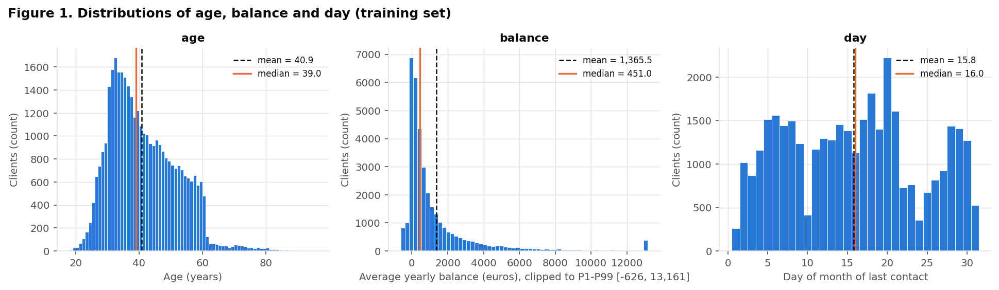

**Figure 1 - conclusion.**
- **`age`** is unimodal and mildly right-skewed (skew 0.69). The mean (40.89) is above the median (39.00), and the mode is 32. 95.50% of clients are 25-60. A thin tail above about 60 holds the IQR outliers (394, 1.09%), which are real older clients.
- **`balance`** is extremely right-skewed (skew 8.34). The mean of 1,365.49 is three times the median of 451.00, and there is a spike at exactly 0 (7.77% of clients). 8.30% are negative (min -8,019) and the max is 102,127. The plot is clipped to P1-P99 [-626, 13,161] for readability.
- **`day`** has no skew (0.09) and no outliers, but it is multimodal, with peaks on specific days (20 (6.1%), 18 (5.0%), 21 (4.5%)) and uneven counts across the month. This reflects call scheduling rather than a smooth quantity.

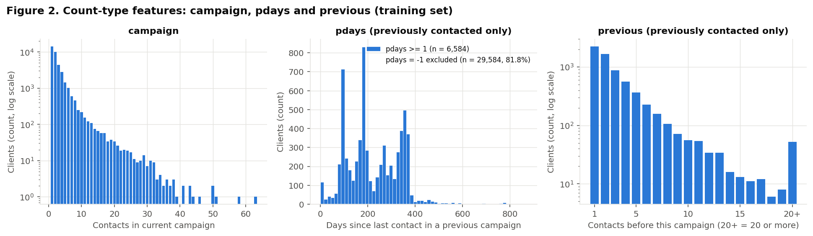

**Figure 2 - conclusion.**
- **`campaign`** is a heavy-tailed count (skew 4.94). The mode is 1 contact (38.78% of clients), 78.69% received at most 3, and 945 clients received more than 10 (max 63).
- **`pdays`** applies only to previously contacted clients (18.20%). Its distribution is multimodal (median 195.00, IQR 133.00-328.00). The most frequent values are 182 (128), 92 (114), 91 (100), 183 (95), 181 (92) days, i.e. clients re-contacted about three or six months after the previous campaign. Figure 2 also shows a further cluster just under 400 days.
- **`previous`** among contacted clients has a median of 2.00 and a mode of 1, with a very long tail up to 275 (skew 28.55).

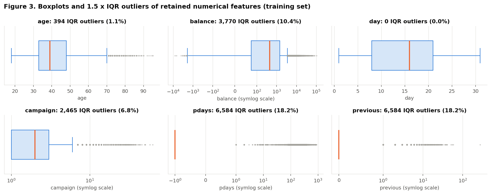

**Figure 3 - conclusion.** Using the 1.5 x IQR rule:
- `balance` has the most real outliers (3,770, 10.42%), on both sides. `campaign` has 2,465 (6.82%) and `age` 394 (1.09%).
- For `pdays` and `previous`, the IQR collapses to the single sentinel value (Q1 = Q3 = -1.00 and 0.00). Every previously contacted client (6,584) is therefore flagged as an "outlier". This is an artifact of the sentinel, not evidence of bad data. Within contacted clients, there are only 40 outliers for `pdays` and 367 for `previous`.
- 4 features have |skew| > 1 (`balance`, `campaign`, `pdays`, `previous`). This motivates rank-based correlation in 3A, and transforms (log/Yeo-Johnson, or binning) and/or robust scaling in Part 2.

### 2B. Categorical features

There are 9 retained categorical features: `job`, `marital`, `education`, `default`, `housing`, `loan`, `contact`, `month`, `poutcome`. Together they have 44 levels (the one-hot width before dropping any reference level).

| feature   |   cardinality | most frequent       | least frequent    | levels < 1%   |   levels < 5% |   "unknown" % |
|:----------|--------------:|:--------------------|:------------------|:--------------|--------------:|--------------:|
| job       |            12 | blue-collar (21.6%) | unknown (0.65%)   | unknown       |             6 |          0.65 |
| marital   |             3 | married (60.2%)     | divorced (11.53%) | -             |             0 |          0.00 |
| education |             4 | secondary (51.3%)   | unknown (4.10%)   | -             |             1 |          4.10 |
| default   |             2 | no (98.2%)          | yes (1.79%)       | -             |             1 |          0.00 |
| housing   |             2 | yes (55.8%)         | no (44.20%)       | -             |             0 |          0.00 |
| loan      |             2 | no (83.9%)          | yes (16.07%)      | -             |             0 |          0.00 |
| contact   |             3 | cellular (64.9%)    | telephone (6.41%) | -             |             0 |         28.72 |
| month     |            12 | may (30.6%)         | dec (0.49%)       | dec           |             5 |          0.00 |
| poutcome  |             4 | unknown (81.8%)     | success (3.33%)   | -             |             2 |         81.81 |

Full frequency tables (training set):

**`job`** (cardinality 12)

| level         |   count |   percent |
|:--------------|--------:|----------:|
| blue-collar   |    7830 |     21.65 |
| management    |    7511 |     20.77 |
| technician    |    6068 |     16.78 |
| admin.        |    4141 |     11.45 |
| services      |    3348 |      9.26 |
| retired       |    1812 |      5.01 |
| self-employed |    1243 |      3.44 |
| entrepreneur  |    1186 |      3.28 |
| unemployed    |    1024 |      2.83 |
| housemaid     |    1013 |      2.80 |
| student       |     758 |      2.10 |
| unknown       |     234 |      0.65 |

**`marital`** (cardinality 3)

| level    |   count |   percent |
|:---------|--------:|----------:|
| married  |   21771 |     60.19 |
| single   |   10227 |     28.28 |
| divorced |    4170 |     11.53 |

**`education`** (cardinality 4)

| level     |   count |   percent |
|:----------|--------:|----------:|
| secondary |   18561 |     51.32 |
| tertiary  |   10594 |     29.29 |
| primary   |    5531 |     15.29 |
| unknown   |    1482 |      4.10 |

**`default`** (cardinality 2)

| level   |   count |   percent |
|:--------|--------:|----------:|
| no      |   35521 |     98.21 |
| yes     |     647 |      1.79 |

**`housing`** (cardinality 2)

| level   |   count |   percent |
|:--------|--------:|----------:|
| yes     |   20182 |     55.80 |
| no      |   15986 |     44.20 |

**`loan`** (cardinality 2)

| level   |   count |   percent |
|:--------|--------:|----------:|
| no      |   30355 |     83.93 |
| yes     |    5813 |     16.07 |

**`contact`** (cardinality 3)

| level     |   count |   percent |
|:----------|--------:|----------:|
| cellular  |   23465 |     64.88 |
| unknown   |   10386 |     28.72 |
| telephone |    2317 |      6.41 |

**`month`** (cardinality 12)

| level   |   count |   percent |
|:--------|--------:|----------:|
| jan     |    1119 |      3.09 |
| feb     |    2078 |      5.75 |
| mar     |     391 |      1.08 |
| apr     |    2394 |      6.62 |
| may     |   11062 |     30.59 |
| jun     |    4237 |     11.71 |
| jul     |    5537 |     15.31 |
| aug     |    4986 |     13.79 |
| sep     |     451 |      1.25 |
| oct     |     592 |      1.64 |
| nov     |    3143 |      8.69 |
| dec     |     178 |      0.49 |

**`poutcome`** (cardinality 4)

| level   |   count |   percent |
|:--------|--------:|----------:|
| unknown |   29589 |     81.81 |
| failure |    3889 |     10.75 |
| other   |    1485 |      4.11 |
| success |    1205 |      3.33 |

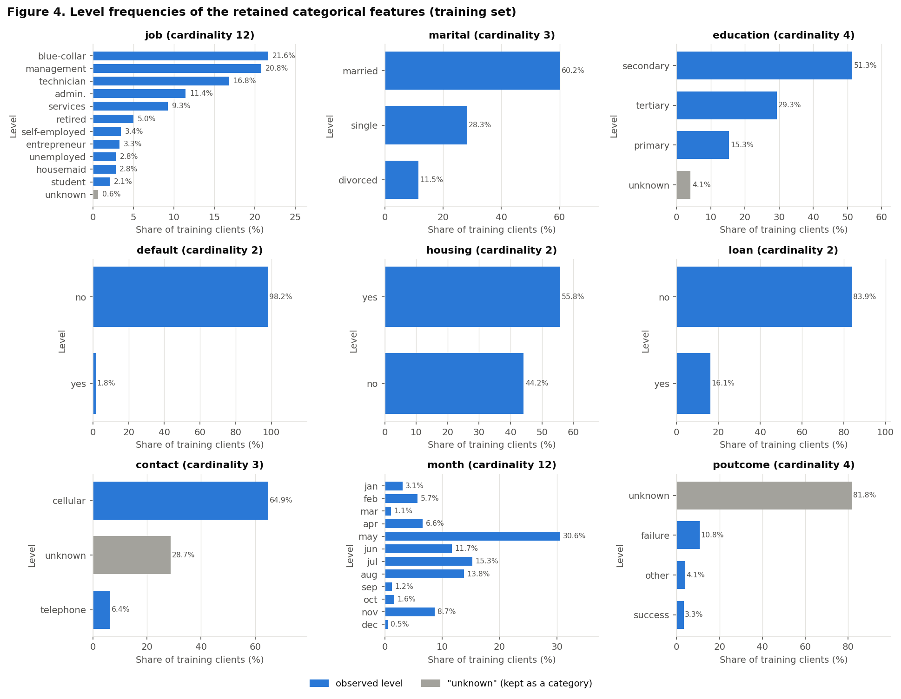

**Figure 4 - conclusion.**
- `job` is dominated by blue-collar (21.6%), management (20.8%) and technician (16.8%) clients.
- `marital` is mostly married (60.2%), and `education` mostly secondary (51.3%).
- `default` is almost constant (98.2% `no`).
- `month` is concentrated in May-August (71.4% of contacts; May alone is 30.6%). March, September, October and December are thin (1.1%, 1.2%, 1.6%, 0.5%).
- `poutcome` is 81.8% `"unknown"`, which is the "never contacted" group.

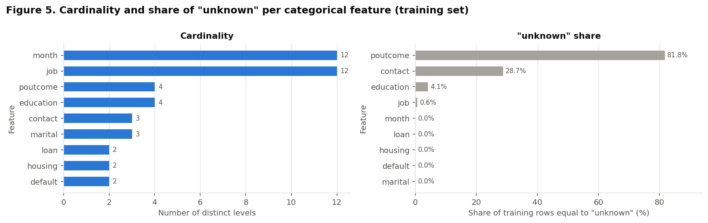

**Figure 5 - conclusion.**
- **No feature has high cardinality.** The maximum is 12 levels (`job`, `month`), so one-hot encoding is feasible.
- **Rare levels (< 1% of training rows):** `job`: unknown; `month`: dec. March, September and October are also small (just over 1%). Their subscription-rate estimates are noisier (see the wide CIs in Figure 9), so Part 2 may consider grouping them if a model overfits.
- **`"unknown"` is substantial** in `poutcome` and `contact`, small in `education`, and marginal in `job`. It is kept as a category (1B).

---

## 3. Bivariate and multivariate analysis (training set)

### 3A. Numerical x numerical

**Choice: Spearman.** 4 of the 6 numerical features are strongly skewed (`balance`, `campaign`, `pdays`, `previous`), and `pdays`/`previous` are dominated by a sentinel/zero mass. Pearson assumes linear relationships and is sensitive to extreme values, while Spearman uses ranks: it captures monotone relationships and is robust to outliers. Pearson is shown only for comparison.

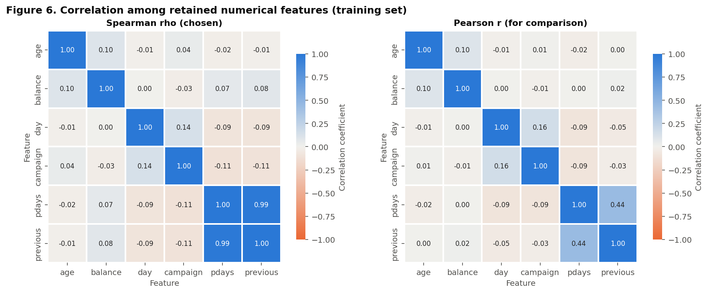

Top pairs by |Spearman|:

| pair                |   spearman |   pearson |
|:--------------------|-----------:|----------:|
| pdays - previous    |      0.986 |     0.439 |
| day - campaign      |      0.139 |     0.162 |
| campaign - pdays    |     -0.112 |    -0.089 |
| campaign - previous |     -0.108 |    -0.031 |
| age - balance       |      0.096 |     0.096 |
| day - pdays         |     -0.093 |    -0.093 |

**Figure 6 - conclusion.**
- The only strongly correlated pair is **`pdays - previous`**: Spearman 0.986, compared with Pearson 0.439. Pearson understates it because the relationship is monotone but far from linear (a large sentinel mass plus long tails).
- All other pairs have |rho| <= 0.139. The next strongest are `day - campaign` (0.139) and `campaign - pdays` (-0.112). Apart from the pair above, the numerical features are close to non-redundant.

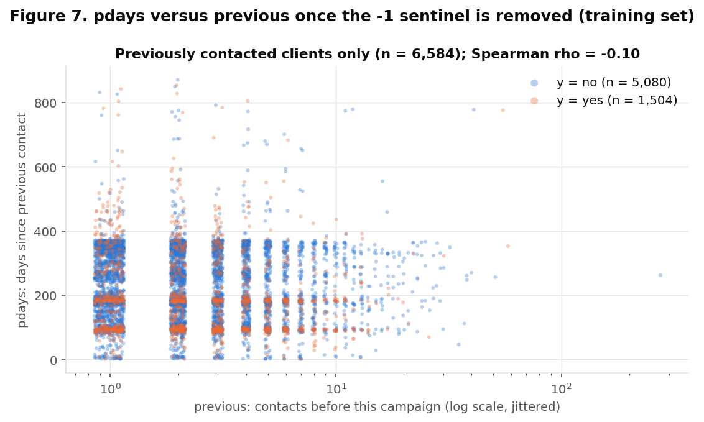

**Figure 7 - conclusion.** The 0.986 correlation is driven almost entirely by the shared sentinel, since `pdays = -1` exactly when `previous = 0` (1B). Among previously contacted clients, Spearman is only -0.099 (Pearson -0.016), so the actual magnitudes are nearly unrelated. **Redundancy:** the two features duplicate the binary "previously contacted" information, not their values. Part 2 should encode that flag once and keep both magnitudes (or test dropping one) instead of treating them as collinear duplicates.

### 3B. Categorical x target

The training base rate is 11.70%. Rates for every level of every categorical feature, with 95% Wilson intervals and lift, are in `part1_outputs/categorical_target_rates_train.csv`. The spread between each feature's highest and lowest level rate:

| feature   |   max - min rate (pp) |
|:----------|----------------------:|
| poutcome  |                  55.4 |
| month     |                  44.2 |
| job       |                  21.6 |
| contact   |                  10.7 |
| housing   |                   9.0 |
| education |                   6.3 |
| default   |                   5.9 |
| loan      |                   5.8 |
| marital   |                   5.0 |

The features with the largest spread are `poutcome` (55.4 pp), `month` (44.2 pp), `job` (21.6 pp). The smallest is `marital` (5.0 pp). The selected figures cover the strongest and most decision-relevant features.

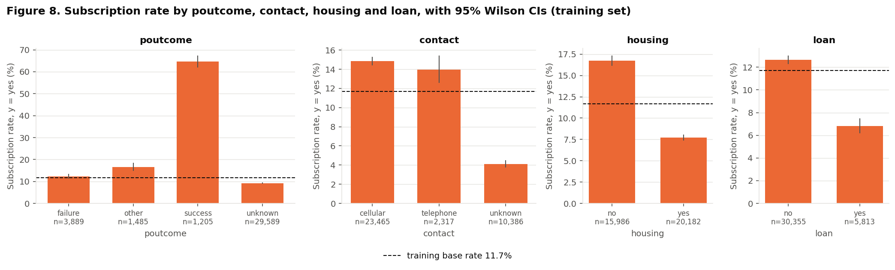

**Figure 8 - conclusion.**
- **`poutcome`** separates the classes most. Clients whose previous campaign was a `success` subscribe at 64.6%, against 12.3% (`failure`), 16.5% (`other`) and 9.2% (`unknown` = never contacted).
- **`contact = unknown`** has a much lower rate (4.1%) than `cellular` (14.8%) and `telephone` (13.9%). This matches the early-period artifact found in 1B, so it partly encodes time.
- Clients **without a housing loan** (16.7% vs 7.7%) or **without a personal loan** (12.6% vs 6.8%) subscribe more often.
- The intervals for `poutcome = success`, `contact = unknown`, `housing` and `loan` do not overlap with their contrasts. `cellular` and `telephone` overlap, so the contact channel itself adds little once `unknown` is separated out.

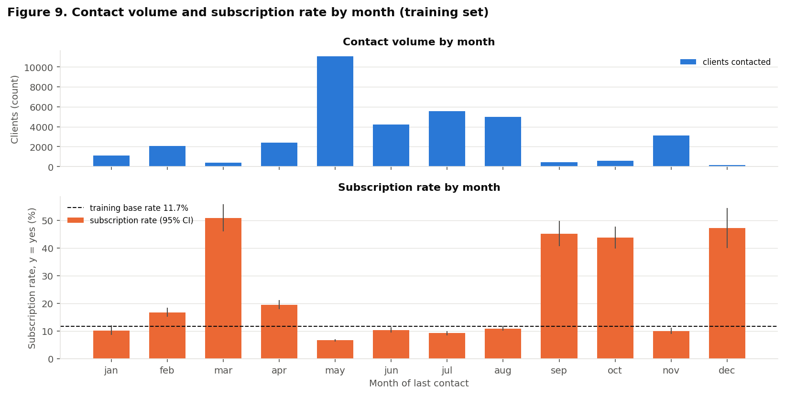

**Figure 9 - conclusion.** Contact volume and subscription rate move in opposite directions (Spearman correlation across the 12 months: -0.87).
- The busiest month has the lowest rate: may (6.7%, n = 11,062).
- Low-volume months have rates above 30%: mar (50.9%, n = 391), sep (45.2%, n = 451), oct (43.8%, n = 592), dec (47.2%, n = 178). The maximum is mar (50.9%, n = 391).
- Volume and rate are drawn as two panels on separate axes, not as a dual-axis chart.
- `month` is strongly predictive, but given the drift found in 1B it likely mixes seasonality with the period of data collection (there is no year column). Its confidence intervals are wide for the thin months.

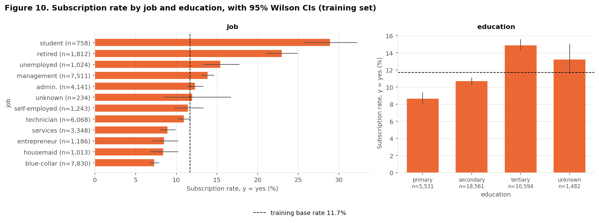

**Figure 10 - conclusion.**
- **`job`:** students (28.9%) and retired clients (23.0%) subscribe far above the base rate. Blue-collar clients (7.3%), housemaids (8.4%), entrepreneurs (8.5%) and services workers (8.9%) subscribe below it.
- **`education`:** the rate increases from primary (8.6%) to secondary (10.7%) to tertiary (14.9%). `unknown` (13.2%) has a wide interval, consistent with its small size.
- These features carry moderate, roughly ordinal signal. `job = unknown` (12.0%) has a very wide interval and is too small to interpret.

### 3C. Numerical x categorical (grouped boxplots, split by `y`)

Each pair below was chosen because 2A/3B suggested a possible interaction, i.e. that the numerical feature's link to `y` might depend on the group. Every boxplot is also split by `y`. Medians and IQRs for every box are in `part1_outputs/grouped_box_stats_train.csv`.

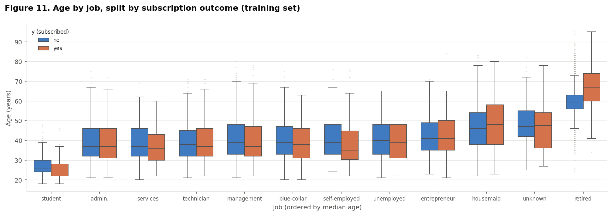

| job           | y   |   rows |   Q1 |   median |   Q3 |   IQR |
|:--------------|:----|-------:|-----:|---------:|-----:|------:|
| admin.        | no  |   3632 | 32.0 |     37.0 | 46.0 |  14.0 |
| admin.        | yes |    509 | 31.0 |     37.0 | 46.0 |  15.0 |
| blue-collar   | no  |   7259 | 33.0 |     39.0 | 47.0 |  14.0 |
| blue-collar   | yes |    571 | 31.0 |     38.0 | 46.0 |  15.0 |
| entrepreneur  | no  |   1085 | 35.0 |     41.0 | 49.0 |  14.0 |
| entrepreneur  | yes |    101 | 35.0 |     41.0 | 50.0 |  15.0 |
| housemaid     | no  |    928 | 38.0 |     46.0 | 54.0 |  16.0 |
| housemaid     | yes |     85 | 38.0 |     48.0 | 58.0 |  20.0 |
| management    | no  |   6470 | 33.0 |     39.0 | 48.0 |  15.0 |
| management    | yes |   1041 | 32.0 |     37.0 | 47.0 |  15.0 |
| retired       | no  |   1396 | 56.0 |     59.0 | 63.0 |   7.0 |
| retired       | yes |    416 | 60.0 |     67.0 | 74.0 |  14.0 |
| self-employed | no  |   1101 | 33.0 |     39.0 | 48.0 |  15.0 |
| self-employed | yes |    142 | 30.2 |     35.0 | 44.8 |  14.5 |
| services      | no  |   3050 | 32.0 |     37.0 | 46.0 |  14.0 |
| services      | yes |    298 | 30.0 |     36.0 | 43.0 |  13.0 |
| student       | no  |    539 | 24.0 |     26.0 | 30.0 |   6.0 |
| student       | yes |    219 | 22.0 |     25.0 | 28.0 |   6.0 |
| technician    | no  |   5405 | 32.0 |     38.0 | 45.0 |  13.0 |
| technician    | yes |    663 | 32.0 |     37.0 | 46.0 |  14.0 |
| unemployed    | no  |    866 | 33.0 |     40.0 | 48.0 |  15.0 |
| unemployed    | yes |    158 | 31.0 |     39.0 | 48.0 |  17.0 |
| unknown       | no  |    206 | 42.0 |     47.0 | 55.0 |  13.0 |
| unknown       | yes |     28 | 36.2 |     47.5 | 54.0 |  17.8 |

**Figure 11 - conclusion.** *Why this pair:* `age` and `job` are strongly linked (students and retirees are at the age extremes), and both have high-rate groups in 3B.
- **Location:** median age ranges from 26 (students, `no`) to 59 (retired, `no`).
- **Within groups:** for most jobs, the `yes` and `no` boxes are within a few years of each other. The clear exception is **retired** clients: those who subscribed are older (median 67 vs 59) and more spread out (IQR 14 vs 7).
- **Overall:** the age effect is non-linear. Clients aged 60+ subscribe at 33.7% (n = 1,447) and those under 25 at 25.6% (n = 657), against 9.8% for ages 30-59. The overall medians by class are almost equal (38 vs 39), which is why a linear age effect would be weak. Part 2 should consider age bins or non-linear models.

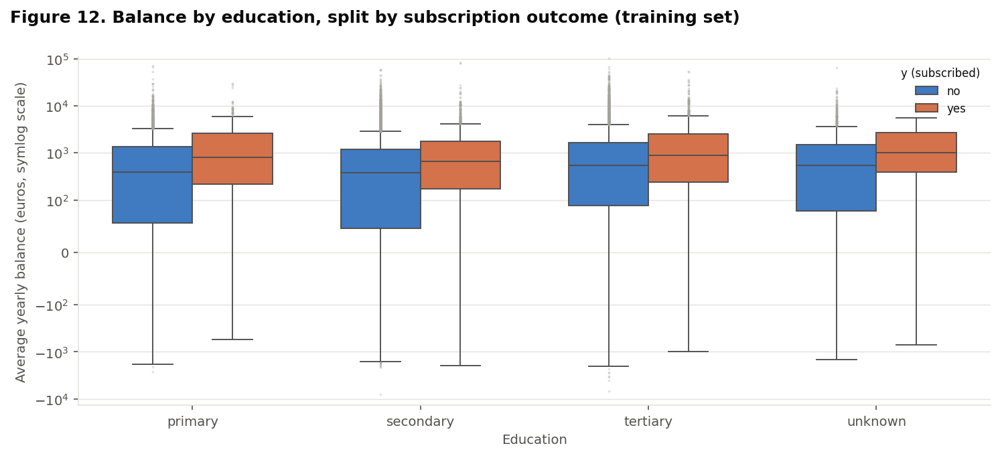

| education   | y   |   rows |    Q1 |   median |     Q3 |    IQR |
|:------------|:----|-------:|------:|---------:|-------:|-------:|
| primary     | no  |   5054 |  56.0 |    390.5 | 1334.2 | 1278.2 |
| primary     | yes |    477 | 217.0 |    796.0 | 2580.0 | 2363.0 |
| secondary   | no  |  16580 |  46.0 |    373.0 | 1177.0 | 1131.0 |
| secondary   | yes |   1981 | 173.0 |    651.0 | 1757.0 | 1584.0 |
| tertiary    | no  |   9017 |  89.0 |    538.0 | 1666.0 | 1577.0 |
| tertiary    | yes |   1577 | 242.0 |    882.0 | 2559.0 | 2317.0 |
| unknown     | no  |   1286 |  79.0 |    534.5 | 1499.8 | 1420.8 |
| unknown     | yes |    196 | 390.8 |   1007.0 | 2667.8 | 2277.0 |

**Figure 12 - conclusion.** *Why this pair:* balance is a likely proxy for the ability to make a deposit, and education is a socioeconomic grouping with an ordinal rate gradient in 3B. The figure checks whether balance still matters within an education level.
- **Location:** within every education level, subscribers have a higher median balance:
  - primary: 796 vs 390.5
  - secondary: 651 vs 373
  - tertiary: 882 vs 538
- **Spread:** subscribers also have a larger IQR (for example tertiary 2,317 vs 1,577).
- The balance effect is therefore not explained by education alone. Long tails on both sides (a symlog axis is needed) confirm that `balance` needs a robust transform.

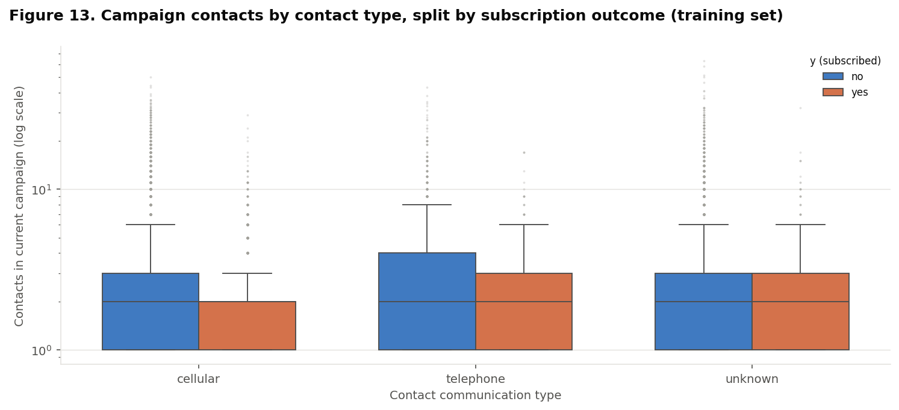

| contact   | y   |   rows |   Q1 |   median |   Q3 |   IQR |
|:----------|:----|-------:|-----:|---------:|-----:|------:|
| cellular  | no  |  19984 |  1.0 |      2.0 |  3.0 |   2.0 |
| cellular  | yes |   3481 |  1.0 |      2.0 |  2.0 |   1.0 |
| telephone | no  |   1994 |  1.0 |      2.0 |  4.0 |   3.0 |
| telephone | yes |    323 |  1.0 |      2.0 |  3.0 |   2.0 |
| unknown   | no  |   9959 |  1.0 |      2.0 |  3.0 |   2.0 |
| unknown   | yes |    427 |  1.0 |      2.0 |  3.0 |   2.0 |

**Figure 13 - conclusion.** *Why this pair:* `campaign` measures call effort, and `contact` is the channel used. This checks whether extra calls relate to subscription in the same way for each channel, and whether the `unknown` (early-period) group behaves differently.
- **Location:** medians are equal (2) in every box, so location barely differs.
- **Spread:** the difference is in the upper tail. For `cellular` and `telephone`, subscribers have a narrower IQR (cellular 1 vs 2; telephone 2 vs 3), while for `unknown` they are equal (2 vs 2). The extreme counts belong mostly to non-subscribers.
- **Overall:** the rate is 14.6% after a single contact and 5.9% after more than 5 contacts (n = 3,483). Repeated calls have diminishing returns. The signal is in the tail, so a capped or log-transformed `campaign` is preferable to the raw count.

---

## 4. Preprocessing

Everything in this stage is implemented in `code/bank_preprocessing.py` (a scikit-learn `Pipeline` + `ColumnTransformer`) and run by `scripts/part2_eda.py`. The intended model is a neural network, which needs a dense, fully numerical input on comparable scales.

**Consistency with Part 1.** Before anything is fitted, the script recomputes 25 quantities from the raw file and stops if any differs from the values saved by Part 1 (`part1_outputs/`). All agree; the full list is in the Appendix. In particular, the split is the one from 1D, row for row: train 36,168 rows, test 9,043 rows.

**No fitting on test data.** Clip bounds, the Yeo-Johnson parameter, means, standard deviations and one-hot levels are learned by `fit(X_train)`. The test set only goes through `transform`. PCA, t-SNE and UMAP (4B) use training rows only.

### 4A. Strategies

Each choice below starts from a check on the data and from a finding of Part 1.

#### Missing values

**Check.** There are 0 `NaN` values in the training predictors and 0 in the test predictors (Part 1, 1B: 0 in the whole file). So there is **nothing to impute** in this dataset.

**Table 4.1 - Categorical checks before encoding (training set; last column compares with the test set).**

| feature     |   NaN (train) |   "unknown" rows (train) |   "unknown" % (train) |   levels (train) |   test levels unseen in train |
|:------------|--------------:|-------------------------:|----------------------:|-----------------:|------------------------------:|
| `job`       |             0 |                      234 |                  0.65 |               12 |                             0 |
| `marital`   |             0 |                        0 |                  0.00 |                3 |                             0 |
| `education` |             0 |                     1482 |                  4.10 |                4 |                             0 |
| `default`   |             0 |                        0 |                  0.00 |                2 |                             0 |
| `housing`   |             0 |                        0 |                  0.00 |                2 |                             0 |
| `loan`      |             0 |                        0 |                  0.00 |                2 |                             0 |
| `contact`   |             0 |                    10386 |                 28.72 |                3 |                             0 |
| `month`     |             0 |                        0 |                  0.00 |               12 |                             0 |
| `poutcome`  |             0 |                    29589 |                 81.81 |                4 |                             0 |

**Strategy.**

- **`"unknown"` stays a category.** Part 1 (1B) showed that it is not missing at random: for `poutcome` it marks clients who were never contacted, for `contact` it marks the early period of the file, and its subscription rate differs (4.1% for `contact = unknown` against 14.8% for `cellular`, Figure 8). Replacing it with the mode would erase that signal, so it is one-hot encoded like any other level.
- **`pdays = -1` is treated as "not applicable", not as a number.** Part 1 (1B, Figure 7) showed that `-1` is a code for "not previously contacted" and coincides exactly with `previous = 0`. The pipeline replaces `-1` by a missing value, standardises `pdays` with the mean and standard deviation of **previously contacted training clients only** (225.09 and 115.32 days, n = 6,584), then fills the masked rows with 0 and adds the indicator column `missingindicator_pdays`. The value 0 is the contacted-client mean, so it is neutral, and the indicator carries the "not previously contacted" information that Part 1 asked to preserve. In the training set the indicator is 1 for 29,584 rows (81.80%).
- **Imputers are safeguards.** The pipeline still contains a median imputer for the numerical features and a constant `"unknown"` imputer for the categorical ones, fitted on the training set. They change **0 values** here. They exist so that `transform` does not fail if future data contains a `NaN`. A `NaN` in a categorical feature would join the existing `"unknown"` level, which is consistent with the decision above.

#### Outliers

**Check.** Part 1 (2A, Figure 3) counted 1.5 x IQR outliers in the training set: `balance` 3,770 (10.42%), `campaign` 2,465, and for `pdays`/`previous` an artifact of the sentinel. No value was impossible (1B), so Part 1 removed no rows and recommended caps or transforms fitted on train. Expressed as z-scores of the raw training values, the extremes reach 32.8 (`balance`), 19.4 (`campaign`) and 113.9 (`previous`) standard deviations. Inputs of that size would dominate the gradients of a neural network.

**Strategy: clip (winsorise), then transform. No row is removed.**

- `balance`, `campaign` and `previous` are clipped to the **1st and 99th percentiles of the training set**. For the two counts the 1st percentile equals the minimum, so only the upper tail is clipped.
- `balance` then goes through a Yeo-Johnson power transform (fitted lambda 0.818). It is used instead of a logarithm because -626.33 is negative: overdrawn accounts are valid (1B).
- `campaign` and `previous` are counts, so they get `log1p`. This matches Part 1's finding that the signal of `campaign` is in the tail and has diminishing returns (Figure 13).
- **Why clipping is needed, not only a transform.** Yeo-Johnson on the unclipped `balance` still leaves standardised values between -33.8 and 21.1. After clipping the range is -3.32 to 4.16.
- `age` and `day` are not clipped. `age` is only mildly skewed (0.69) and its extremes are informative: clients aged 60+ subscribe at 33.7% against 9.8% for ages 30-59 (Figure 11). `day` has no outliers (Figure 3).
- `pdays` is not clipped. Once the sentinel is masked, it has few outliers among contacted clients (2A) and its standardised range is -1.94 to 5.60.

**Table 4.2 - Rows changed by clipping.** Bounds are learned on the training set and applied unchanged to the test set.

| feature          |   lower bound (train P1) |   upper bound (train P99) |   train rows below |   train rows above |   train rows clipped |   train % |   test rows clipped |   test % |
|:-----------------|-------------------------:|--------------------------:|-------------------:|-------------------:|---------------------:|----------:|--------------------:|---------:|
| `balance`        |                  -626.33 |                 13,161.32 |                362 |                362 |                  724 |      2.00 |                 184 |     2.03 |
| `campaign`       |                     1.00 |                     16.33 |                  0 |                362 |                  362 |      1.00 |                  89 |     0.98 |
| `previous`       |                     0.00 |                      9.00 |                  0 |                296 |                  296 |      0.82 |                  65 |     0.72 |
| any of the three |                        - |                         - |                  - |                  - |                1,372 |      3.79 |                 333 |     3.68 |

**1,372 training rows (3.79%) have at least one clipped value**, and 333 test rows (3.68%). Clipped training rows subscribe at 10.1%, against 11.8% for the others. Clipping keeps their rank at the top of the scale but removes the distinction among them, which is the cost of this strategy.

#### Categorical encoding

- **One-hot encoding** with `OneHotEncoder(handle_unknown="ignore")`, with no reference level dropped. Part 1 (2B, Figure 5) found low cardinality: at most 12 levels per feature and 44 levels in total. The features are nominal (`month` is cyclical and `education` has an `unknown` level), so integer codes would impose an order that the data does not have.
- **Unseen categories.** The test set contains 0 levels that are absent from the training set (Table 4.1). `handle_unknown="ignore"` is still set: a level that appears later is encoded as all zeros for that feature instead of raising an error. This matters most for the rare levels found in Part 1 (`job`: unknown; `month`: dec).
- No level is dropped because a neural network does not need a reference category, and dropping one would make the all-zeros row of an unseen level indistinguishable from the reference level.
- Rare levels are not grouped. Part 1 suggested grouping only if a model overfits, which cannot be judged before modelling.

#### Scaling

**Choice: standardisation (zero mean, unit variance), fitted on the training set, applied after clipping and transforming.**

- A neural network is trained by gradient descent on weighted sums of its inputs. Features on very different scales (`balance` in thousands of euros, `campaign` in single units) give badly conditioned gradients and make one learning rate unsuitable for all weights. Standard weight initialisation also assumes inputs centred near zero with variance near one.
- **Min-max scaling was not chosen** because the maximum would be set by the tail: the bulk of `balance` would be squeezed into a small part of [0, 1].
- **Robust scaling alone was not chosen** because it centres and scales by median and IQR but leaves the extremes large. Clipping bounds the tails, and after that the mean and standard deviation are no longer dominated by a few points (the concern raised in 2A).
- One-hot columns and the indicator stay as 0/1. They are already bounded and on a scale comparable to standardised features.

**Table 4.3 - Numerical features before and after the pipeline (training set, except the last two columns).** "Raw min z / max z" are the z-scores the raw values would have with plain standardisation.

| feature    | treatment                                                     |   raw skew |   raw min z |   raw max z |   output mean |   output std |   output skew |   output min |   output max |   test output min |   test output max |
|:-----------|:--------------------------------------------------------------|-----------:|------------:|------------:|--------------:|-------------:|--------------:|-------------:|-------------:|------------------:|------------------:|
| `age`      | standardise                                                   |       0.69 |       -2.15 |        5.09 |         -0.00 |         1.00 |          0.69 |        -2.15 |         5.09 |             -2.15 |              4.90 |
| `day`      | standardise                                                   |       0.09 |       -1.78 |        1.82 |          0.00 |         1.00 |          0.09 |        -1.78 |         1.82 |             -1.78 |              1.82 |
| `balance`  | clip P1-P99, Yeo-Johnson, standardise                         |       8.34 |       -3.06 |       32.84 |         -0.00 |         1.00 |          1.03 |        -3.32 |         4.16 |             -3.32 |              4.16 |
| `campaign` | clip P1-P99, log1p, standardise                               |       4.94 |       -0.57 |       19.41 |         -0.00 |         1.00 |          1.16 |        -0.93 |         3.40 |             -0.93 |              3.40 |
| `previous` | clip P1-P99, log1p, standardise                               |      45.03 |       -0.24 |      113.93 |         -0.00 |         1.00 |          2.34 |        -0.43 |         4.03 |             -0.43 |              4.03 |
| `pdays`    | mask -1, standardise on contacted clients, fill 0 + indicator |       2.62 |       -0.41 |        8.30 |          0.00 |         0.43 |          1.61 |        -1.94 |         5.60 |             -1.94 |              5.31 |

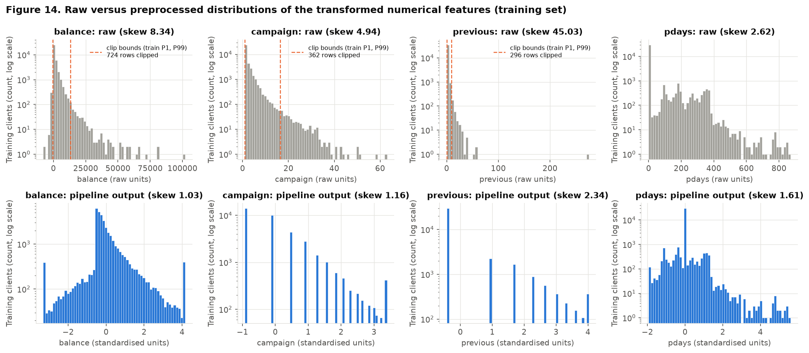

**Figure 14 - conclusion.**
- The raw tails (top row) are shortened to a bounded range (bottom row). The largest absolute value in the whole transformed matrix is 5.60 in train and 5.31 in test, down from 113.9 standard deviations for raw `previous`.
- Skew drops from 8.34 to 1.03 for `balance` and from 4.94 to 1.16 for `campaign`. The bars at both ends of `balance` and at the upper end of the counts are the clipped rows.
- `previous` remains skewed (2.34, from 45.03). This cannot be removed: 81.80% of the rows are exactly 0, and no monotone transform spreads a point mass.
- `pdays` has standard deviation 0.43 over all rows, not 1, because it is standardised among contacted clients and is 0 for everyone else. The spike at 0 is the never-contacted group.

### 4B. Dimensionality reduction

**Input.** The 51 preprocessed features of the **training set only** (4C). Points are coloured by the target.

**Sample.** PCA is fitted on all 36,168 training rows. t-SNE and UMAP are computed on a sample, because t-SNE is slow on the full set and a scatter of 36 thousand points is unreadable. The sample is **5,000 training rows (13.8% of train)**, drawn with `train_test_split(train_size=5000, stratify=y_train, random_state=42)`. It keeps the class balance: 585 `yes` (11.70%). The same sample is used in Figures 17 to 20, and all methods use `random_state=42`.

#### PCA

**Table 4.4 - Explained variance of the first 10 principal components.**

| component   |   explained variance % |   cumulative % |
|:------------|-----------------------:|---------------:|
| PC1         |                  14.90 |          14.90 |
| PC2         |                  12.55 |          27.45 |
| PC3         |                  11.22 |          38.68 |
| PC4         |                   9.76 |          48.43 |
| PC5         |                   8.61 |          57.04 |
| PC6         |                   6.65 |          63.69 |
| PC7         |                   4.46 |          68.15 |
| PC8         |                   3.78 |          71.93 |
| PC9         |                   3.21 |          75.14 |
| PC10        |                   2.71 |          77.85 |

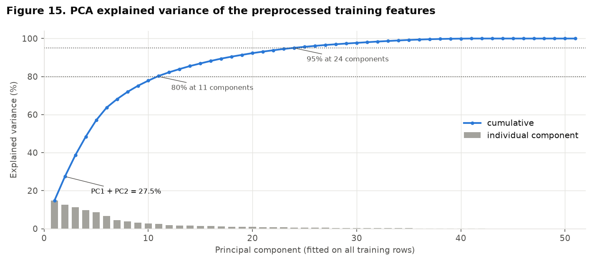

**Figure 15 - conclusion.**
- **PC1 + PC2 explain 27.45%** of the variance (PC1 14.90%, PC2 12.55%). A 2D PCA plot therefore hides almost three quarters of the variance.
- Variance is spread over many directions: 11 components are needed for 80%, 18 for 90% and 24 for 95%. There is no low-dimensional linear structure, which agrees with the near-zero correlations among numerical features found in 3A (Figure 6).
- The last 9 components have zero variance. This is expected: each of the 9 one-hot groups sums to 1, which gives 9 exact linear dependencies.
- The 6 numerical columns carry 52.9% of the total variance and the 45 binary columns 47.1%, because a 0/1 column has variance of at most 0.25. PCA therefore weights numerical features more than categorical ones. This is a property of the encoding and not evidence that the numerical features are more important for `y`.

**Table 4.5 - Largest loadings of PC1 and PC2.**

| PC1 feature              |   PC1 loading | PC2 feature       |   PC2 loading |
|:-------------------------|--------------:|:------------------|--------------:|
| `previous`               |        +0.732 | `age`             |        +0.739 |
| `campaign`               |        -0.348 | `balance`         |        +0.495 |
| `day`                    |        -0.307 | `campaign`        |        +0.186 |
| `missingindicator_pdays` |        -0.277 | `housing_no`      |        +0.168 |
| `poutcome_unknown`       |        -0.276 | `housing_yes`     |        -0.168 |
| `poutcome_failure`       |        +0.164 | `marital_single`  |        -0.166 |
| `balance`                |        +0.156 | `marital_married` |        +0.143 |
| `contact_cellular`       |        +0.113 | `month_may`       |        -0.125 |

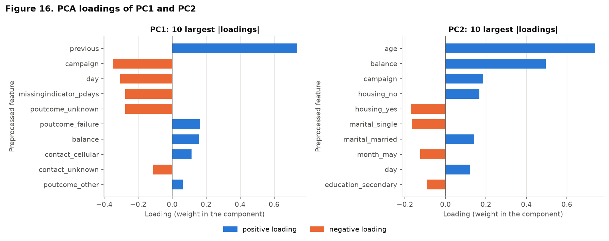

**Figure 16 - conclusion (loadings).**
- **PC1 is a "contact history" axis.** It has `previous` (+0.73) at one end and the not-previously-contacted indicator (-0.28) and `poutcome_unknown` (-0.28) at the other. These three move together, as Part 1 found (1B; Figure 7). `campaign` (-0.35) and `day` (-0.31) have the opposite sign to `previous`, consistent with their small negative correlations with `previous` and `pdays` in 3A. The magnitude of `pdays` has almost no weight (-0.01), which matches the finding that `pdays` and `previous` are nearly unrelated once the sentinel is removed (Spearman -0.099).
- **PC2 is an "age and wealth" axis.** It is led by `age` (+0.74) and `balance` (+0.50), with `housing_no`, `marital_married` on the same side and `housing_yes`, `marital_single` on the other: older clients with higher balances and no housing loan.
- The five largest loadings account for 90.4% of PC1 and 88.2% of PC2 (sum of squared loadings), so each axis is described by a handful of features. `month` and `job`, which had large subscription-rate spreads in 3B, barely appear, for the variance reason given above.

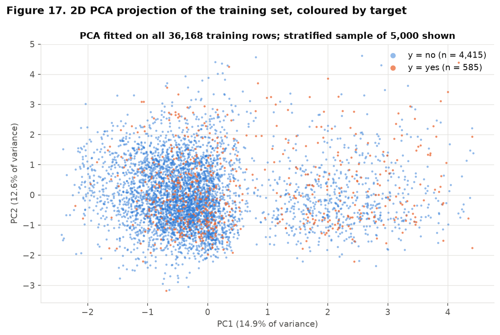

**Figure 17 - conclusion.**
- The projection shows two clouds along PC1. From the loadings, the right-hand cloud is the previously contacted clients and the large left-hand cloud is the never-contacted majority.
- **The classes overlap in both clouds.** `yes` points are relatively more frequent on the right, but no line separates them. The class means differ by +0.59 pooled standard deviations on PC1 and by +0.22 on PC2 (all training rows).
- A linear view of the two highest-variance directions is therefore not enough to separate subscribers. This is expected, since PCA does not use `y` and these two components hold only 27.45% of the variance.

#### t-SNE

Perplexities compared: 5, 30, 50. Settings: `init="pca"`, `learning_rate="auto"`, default number of iterations, `random_state=42`.

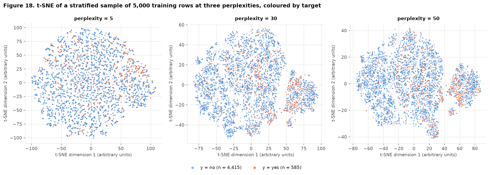

**Figure 18 - conclusion.**
- **Perplexity 5** breaks the data into many tiny groups of near-identical profiles. Only very local neighbourhoods are kept and no larger structure is visible.
- **Perplexity 30 and 50** show one island that is separated from the main mass and has a visibly higher density of `yes` points. The main mass contains smaller pockets where `yes` is more frequent, but most of it is mixed.
- The island appears at both larger perplexities, so it is not an artifact of a single setting. The layout of the main mass changes between panels and should not be interpreted.

#### UMAP

`n_neighbors` compared: 5, 15, 50. Settings: `min_dist=0.1`, Euclidean metric, `random_state=42`.

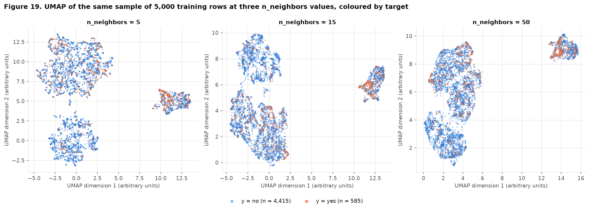

**Figure 19 - conclusion.**
- All three settings isolate one compact island with a high share of `yes`, the same structure that t-SNE finds.
- With `n_neighbors` = 5 and 15, the remaining points form two further groups. With `n_neighbors` = 50, which gives more weight to global structure, these two groups join into one connected mass while the first island stays apart.
- Inside the two large groups, `yes` and `no` are mixed, with `yes` slightly concentrated along some edges.

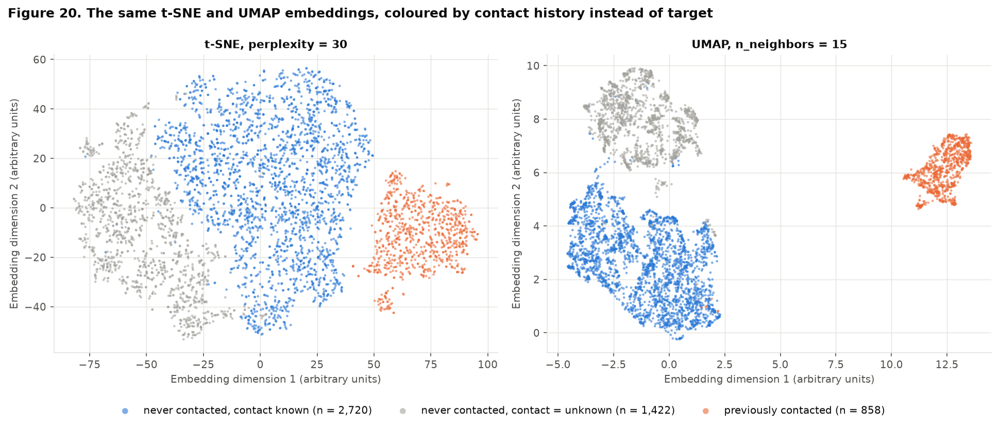

**Figure 20 - conclusion.** Colouring the same embeddings by two features identified in Part 1 explains the islands:
- The isolated island is the **previously contacted** clients (n = 858 in the sample, subscription rate 23.3%).
- The other two groups are never-contacted clients, split by whether `contact` is `unknown` (n = 1,422, rate 4.4%) or known (n = 2,720, rate 11.9%).
- The visible structure is therefore **defined by contact history and by the recording period** (1B showed that `contact = unknown` marks the early part of the file), not by the target. The groups differ in subscription rate, but within each group the classes are mixed.

#### What t-SNE and UMAP reveal relative to PCA

- **PCA** gives one interpretable linear axis (contact history) and shows two overlapping clouds. It hides the `contact = unknown` group, because that group differs in binary columns with little variance.
- **t-SNE and UMAP** use local neighbourhoods in all 51 dimensions. They separate the previously contacted clients cleanly, and UMAP also separates the `contact = unknown` group. These groups are defined by categorical features that PCA down-weights.
- **None of the three methods separates `yes` from `no`.** All three agree that subscribers are more frequent among previously contacted clients and are otherwise spread through the majority. The class boundary is not a simple low-dimensional one, so a model will need non-linear combinations of features, and high accuracy on the minority class should not be expected from these inputs alone.

**Interpretation limits.** In t-SNE and UMAP plots, **the size of a cluster, the distance between clusters and the density of points have no direct quantitative interpretation.** The axes have arbitrary units. Both methods preserve neighbourhoods, not distances: a large island is not a large or spread-out group, and two islands that are far apart are not "more different" than two that are close. The layouts also change with perplexity, `n_neighbors` and the random seed. Only structure that persists across settings (here, the previously contacted island) is treated as a finding, and it was confirmed with the original features (Figure 20), not from the plot alone. These embeddings are diagnostic plots only; they are not used as model inputs.

### 4C. Pipeline

`build_preprocessor()` in `code/bank_preprocessing.py` returns an unfitted `Pipeline` whose single step is this `ColumnTransformer`:

| Branch | Columns | Steps (in order) | Justified by |
|---|---|---|---|
| `standard` | `age`, `day` | median imputer (safeguard) -> `StandardScaler` | mild skew, no clipping needed (2A) |
| `signed` | `balance` | median imputer (safeguard) -> clip to train P1-P99 -> Yeo-Johnson with standardisation | heavy tails on both sides, negative values (2A, Figure 12) |
| `count` | `campaign`, `previous` | median imputer (safeguard) -> clip to train P1-P99 -> `log1p` -> `StandardScaler` | heavy-tailed counts (2A, Figure 13) |
| `sentinel` | `pdays` | mask `-1` -> `StandardScaler` (contacted clients) -> constant imputer 0 with indicator | sentinel analysis (1B, Figure 7) |
| `categorical` | 9 categorical features | constant `"unknown"` imputer (safeguard) -> `OneHotEncoder(handle_unknown="ignore")` | `"unknown"` as category (1B), low cardinality (2B) |

`duration` is not an input: it was excluded as leakage in 1B, and `load_data()` never selects it.

**Usage.** The pipeline is fitted on `X_train` only and the test set is only transformed:

```python
import sys; sys.path.insert(0, "code")
from bank_preprocessing import load_data, split, build_preprocessor

X, y = load_data()                                  # 15 predictors, y: yes = 1, no = 0
X_train, X_test, y_train, y_test = split(X, y)      # the Part 1 split (1D)
pre = build_preprocessor().fit(X_train)             # training set only
Z_train = pre.transform(X_train)
Z_test = pre.transform(X_test)                      # transform only
feature_names = pre.get_feature_names_out()
```

**Verification** (output of `python code/bank_preprocessing.py`, repeated as assertions in `scripts/part2_eda.py`):

| Check | Result |
|---|---|
| `NaN` in raw `X_train` / `X_test` | 0 / 0 |
| `NaN` after transform, train / test | **0 / 0** |
| Infinite values after transform | 0 |
| Transformed training shape | **36,168 x 51** |
| Transformed test shape | **9,043 x 51** |
| Output columns | 51 = 6 numerical + 1 indicator + 44 one-hot |
| Test levels unseen in train | 0 |

**Table 4.6 - Feature names after preprocessing** (in output order; also in `part2_outputs/feature_names.csv`).

| group                           |   columns | feature names                                                                                                                                                                                                |
|:--------------------------------|----------:|:-------------------------------------------------------------------------------------------------------------------------------------------------------------------------------------------------------------|
| standardised numerical          |         2 | `age`, `day`                                                                                                                                                                                                 |
| clipped + transformed numerical |         3 | `balance`, `campaign`, `previous`                                                                                                                                                                            |
| `pdays` and its indicator       |         2 | `pdays`, `missingindicator_pdays`                                                                                                                                                                            |
| one-hot `job`                   |        12 | `job_admin.`, `job_blue-collar`, `job_entrepreneur`, `job_housemaid`, `job_management`, `job_retired`, `job_self-employed`, `job_services`, `job_student`, `job_technician`, `job_unemployed`, `job_unknown` |
| one-hot `marital`               |         3 | `marital_divorced`, `marital_married`, `marital_single`                                                                                                                                                      |
| one-hot `education`             |         4 | `education_primary`, `education_secondary`, `education_tertiary`, `education_unknown`                                                                                                                        |
| one-hot `default`               |         2 | `default_no`, `default_yes`                                                                                                                                                                                  |
| one-hot `housing`               |         2 | `housing_no`, `housing_yes`                                                                                                                                                                                  |
| one-hot `loan`                  |         2 | `loan_no`, `loan_yes`                                                                                                                                                                                        |
| one-hot `contact`               |         3 | `contact_cellular`, `contact_telephone`, `contact_unknown`                                                                                                                                                   |
| one-hot `month`                 |        12 | `month_apr`, `month_aug`, `month_dec`, `month_feb`, `month_jan`, `month_jul`, `month_jun`, `month_mar`, `month_may`, `month_nov`, `month_oct`, `month_sep`                                                   |
| one-hot `poutcome`              |         4 | `poutcome_failure`, `poutcome_other`, `poutcome_success`, `poutcome_unknown`                                                                                                                                 |

**Run from a clean clone.** The raw file `data/raw/bank-full.csv` is committed, so no download is needed. If it is missing, `python scripts/part1_download_data.py` fetches it from the UCI archive.

```
python -m venv .venv
.venv\Scripts\activate            (Windows; on Linux/macOS: source .venv/bin/activate)
pip install -r requirements.txt
python code/bank_preprocessing.py
```

The last command fits the pipeline on the training set and prints the shapes, the `NaN` counts, the clip bounds, the clipped rows and the 51 feature names. Add `--out data/processed` to also write the transformed matrices as CSV.

---

## 5. Synthesis

### 5A. Main findings

| # | Finding | Evidence |
|---|---|---|
| 1 | The data is clean in the usual sense: 0 `NaN`, 0 exact duplicate rows, no impossible values. Missing information is coded as `"unknown"`, mostly in `poutcome` (full data: 36,959 (81.75%)) and `contact` (13,020 (28.80%)). | 1B missing-value and consistency tables; Figure 5; Table 4.1 |
| 2 | The target is imbalanced: 11.70% `yes`, ratio 7.55 : 1. Always predicting `no` gives 88.30% accuracy. | 1C table; 1D table |
| 3 | `duration` is target leakage and is excluded. It is the only dropped column. | 1B leakage table (duration bins) |
| 4 | The file is chronological and the subscription rate drifts from 3.0% to 47.1% across row deciles. `contact = unknown` and `month` partly encode the period. | 1B row-decile table; Figures 8 and 9 |
| 5 | `pdays = -1` is a code for "not previously contacted" (81.74% of rows) and coincides with `previous = 0`. The 0.986 Spearman correlation of `pdays - previous` comes from this shared code; among contacted clients it is -0.099. | 1B sentinel table; Figures 6 and 7 |
| 6 | Contact history is the strongest signal: `poutcome = success` subscribes at 64.6% against 9.2% for never-contacted clients. It is also the main axis of variance (PC1) and the group that t-SNE and UMAP isolate. | Figure 8; Figures 16, 18, 19, 20 |
| 7 | `month` has a large rate spread, from may (6.7%, n = 11,062) to mar (50.9%, n = 391), with volume and rate moving in opposite directions. | Figure 9; 3B spread table |
| 8 | Numerical effects are non-linear: the age effect is U-shaped (33.7% for 60+ against 9.8% for 30-59) and repeated calls have diminishing returns (14.6% after one contact, 5.9% after more than five). | Figures 11 and 13 |
| 9 | `balance`, `campaign` and `previous` are heavy-tailed (skew 8.34, 4.94, 45.03). Clipping at train P1-P99 changes 1,372 training rows (3.79%) and, with a transform and standardisation, bounds every input to within 5.60 standard deviations. | Figures 1-3; Tables 4.2 and 4.3; Figure 14 |
| 10 | There is no low-dimensional linear structure and no clean class separation: PC1 + PC2 explain 27.45%, 18 components are needed for 90%, and the classes overlap in PCA, t-SNE and UMAP. | Table 4.4; Figures 15, 17, 18, 19 |
| 11 | The preprocessing pipeline turns 15 predictors into 51 features with no `NaN`: train 36,168 x 51, test 9,043 x 51. | 4C verification table; Table 4.6 |

### 5B. Modelling risks and handling plan

| # | Risk | Evidence | Handling plan |
|---|---|---|---|
| 1 | **Class imbalance** (7.55 : 1). Accuracy is misleading and a network can collapse to predicting `no`. | 1C | Keep stratification in every split and in cross-validation. Report PR-AUC, recall and precision on `yes` and balanced accuracy, with the 88.30% majority baseline for reference. Use class weights in the loss, computed on the training set. Choose the decision threshold on a validation set, never on the test set. |
| 2 | **Time drift and an optimistic split.** The random stratified split mixes periods, so test performance overstates performance on future campaigns. | 1B row-decile table | State this limitation with every result. As a sensitivity check, also evaluate with a chronological split (train on the first 80% of rows, test on the last 20%) and report the gap. Never use the row index as a feature. |
| 3 | **Period proxies.** `contact = unknown` and `month` may be learned as "which period" instead of a client property. | 1B; Figures 8, 9 and 20 | Train an ablation without `contact` and `month` and compare. If the chronological check (risk 2) shows a large drop, prefer the model without them. |
| 4 | **Leakage.** `duration` would inflate every metric. | 1B | `duration` is never loaded by `load_data()`. Keep all fitted preprocessing inside the pipeline so that cross-validation refits it on each training fold. |
| 5 | **Redundant "never contacted" information.** The indicator, `poutcome_unknown` and `previous = 0` say almost the same thing (they differ in 5 training rows). | 1B; 3A; Figure 16 | Harmless for prediction with a neural network, but it makes single weights uninterpretable. Use weight decay, and do not read importance from individual weights. Test dropping the indicator. |
| 6 | **Rare levels and near-constant columns** (`job`: unknown; `month`: dec; `default = yes` is 1.80%). Their weights are estimated from few rows and can overfit. | 2B; Figures 5 and 9 | Weight decay or dropout plus early stopping on a validation set. If validation shows overfitting, group the rare months and test dropping `default`. `handle_unknown="ignore"` covers levels missing from a fold. |
| 7 | **Clipping removes information** about the 3.79% most extreme clients. | Table 4.2 | The clip quantiles are parameters of `QuantileClipper`. Treat them as a hyperparameter (for example P0.5-P99.5, or no clipping) and select on validation data only. |
| 8 | **Weak, non-linear signal.** No projection separates the classes, and the age and campaign effects are non-linear. | Figures 11, 13, 17, 18, 19 | Start from a logistic-regression baseline on the same features, then a small network with hidden layers. Expect modest gains, and compare against the baseline instead of against published results that use `duration`. |
| 9 | **Over-reading the embeddings.** t-SNE and UMAP cluster sizes and distances are not quantitative. | 4B | Use them only as diagnostics. Do not feed them to the model or pick thresholds from them. |
| 10 | **Feature-level duplicates** (16 rows) could sit on both sides of the split. | 1B | Negligible share; kept, as decided in Part 1. If cross-validation is used, note that it does not affect the conclusions. |
| 11 | **Approval is pending.** The dataset has not been approved by the instructor. | Section 0 | Obtain and document the approval before treating this EDA as final. If the dataset is rejected, the scripts are reusable but every number changes. |

### 5C. Summary table

| # | Item | Value |
|---|---|---|
| 1 | Dataset, task and target | UCI Bank Marketing (`bank-full.csv`, older full version). Binary classification. Target `y`: did the client subscribe to a term deposit (`yes` = 1, `no` = 0). **Instructor approval: pending.** |
| 2 | Instances x features (numerical / categorical) | 45,211 x 16 input features (7 numerical / 9 categorical) plus the target. After excluding `duration`: 45,211 x 15 (6 numerical / 9 categorical). |
| 3 | Column with the most missing values and its percentage | No column has `NaN` (0.00% everywhere). Missing information is coded as `"unknown"`: the highest share is `poutcome`, 36,959 (81.75%) of the full data. |
| 4 | Dropped columns and reasons | `duration`: target leakage, known only during or after the call (1B). No other column and no row is dropped. |
| 5 | Minority class percentage | `yes`: 11.70% (5,289 of 45,211); ratio 7.55 : 1. |
| 6 | Training and test sizes | Train 36,168 rows (4,231 `yes`, 11.70%); test 9,043 rows (1,058 `yes`, 11.70%). Stratified 80/20, `random_state=42`. |
| 7 | Most correlated numerical pair and correlation | `pdays - previous`: Spearman 0.986 (Pearson 0.439), training set. Driven by the shared sentinel; -0.099 among previously contacted clients. |
| 8 | Rows affected by the outlier strategy | Clipping to train P1-P99 of `balance`, `campaign`, `previous`: 1,372 training rows (3.79%) and 333 test rows (3.68%) have at least one clipped value. 0 rows removed. |
| 9 | Variance explained by PC1 + PC2 | 27.45% (PC1 14.90% + PC2 12.55%), PCA on the 51 preprocessed training features. |
| 10 | Train / test shapes after preprocessing | Train 36,168 x 51; test 9,043 x 51. 0 `NaN` in both. |

**Remaining blocker.** Instructor approval of the dataset is not documented in the repository. Everything else in this report was computed and checked from the data.

---

## Appendix. Reproducibility

**Run everything from a clean clone** (from the repository root, after `pip install -r requirements.txt`):

```
python scripts/part1_eda.py            # stages 0-3: part1_figures/, part1_outputs/, part1_draft.md
python code/bank_preprocessing.py      # stage 4C checks only
python scripts/part2_eda.py            # stages 4-5: part2_figures/, part2_outputs/, index.md
```

- `data/raw/bank-full.csv` is committed. `python scripts/part1_download_data.py` downloads it again from UCI if needed.
- Stages 4-5 were last generated with Python 3.12.6, pandas 2.3.3, numpy 2.5.4, scikit-learn 1.9.1, umap-learn 0.5.12, matplotlib 3.11.2.
- **Data integrity.** The file's SHA-256 is checked on load after normalising line endings to LF (`d1513ec63b385506f7cfce9f2c5caa9fe99e7ba4e8c3fa264b3aaf0f849ed32d`, the value recorded in 1A), because git may check the file out with CRLF line endings on Windows. The parsed data is identical in both cases.
- `random_state=42` is used for the split, the plotting sample, PCA, t-SNE and UMAP. t-SNE and UMAP coordinates can still differ slightly across library versions or machines; the conclusions in 4B rely only on structure that is stable across settings.

**Agreement with Part 1.** Values recomputed by `scripts/part2_eda.py` and compared with `part1_outputs/` (the script stops on any mismatch):

| quantity                                                  | Part 1                                                                                        | recomputed in Part 2                                                                          |
|:----------------------------------------------------------|:----------------------------------------------------------------------------------------------|:----------------------------------------------------------------------------------------------|
| bank-full.csv SHA-256 (LF line endings)                   | d1513ec63b385506f7cfce9f2c5caa9fe99e7ba4e8c3fa264b3aaf0f849ed32d                              | d1513ec63b385506f7cfce9f2c5caa9fe99e7ba4e8c3fa264b3aaf0f849ed32d                              |
| rows x columns of bank-full.csv                           | 45,211 x 17                                                                                   | 45,211 x 17                                                                                   |
| retained numerical features                               | ['age', 'balance', 'day', 'campaign', 'pdays', 'previous']                                    | ['age', 'balance', 'day', 'campaign', 'pdays', 'previous']                                    |
| retained categorical features                             | ['job', 'marital', 'education', 'default', 'housing', 'loan', 'contact', 'month', 'poutcome'] | ['job', 'marital', 'education', 'default', 'housing', 'loan', 'contact', 'month', 'poutcome'] |
| excluded columns                                          | ['duration']                                                                                  | ['duration']                                                                                  |
| NaN values in the file                                    | 0                                                                                             | 0                                                                                             |
| minority class (y = yes) share                            | 11.70%                                                                                        | 11.70%                                                                                        |
| imbalance ratio no : yes                                  | 7.55                                                                                          | 7.55                                                                                          |
| column with most "unknown"                                | poutcome                                                                                      | poutcome                                                                                      |
| poutcome = "unknown" (full data)                          | 36,959 (81.75%)                                                                               | 36,959 (81.75%)                                                                               |
| pdays = -1 rows equal to previous = 0 rows (mismatches)   | 0                                                                                             | 0                                                                                             |
| train row ids identical to train_test_split_indices.csv   | True                                                                                          | True                                                                                          |
| test row ids identical to train_test_split_indices.csv    | True                                                                                          | True                                                                                          |
| train rows / positives                                    | 36,168 / 4,231                                                                                | 36,168 / 4,231                                                                                |
| test rows / positives                                     | 9,043 / 1,058                                                                                 | 9,043 / 1,058                                                                                 |
| most correlated numerical pair (train, absolute Spearman) | pdays - previous                                                                              | pdays - previous                                                                              |
| its Spearman rho                                          | 0.986                                                                                         | 0.986                                                                                         |
| its Pearson r                                             | 0.439                                                                                         | 0.439                                                                                         |
| balance: 1.5 x IQR outliers (train)                       | 3,770                                                                                         | 3,770                                                                                         |
| balance: skew (train)                                     | 8.34                                                                                          | 8.34                                                                                          |
| campaign: 1.5 x IQR outliers (train)                      | 2,465                                                                                         | 2,465                                                                                         |
| campaign: skew (train)                                    | 4.94                                                                                          | 4.94                                                                                          |
| previous: 1.5 x IQR outliers (train)                      | 6,584                                                                                         | 6,584                                                                                         |
| previous: skew (train)                                    | 45.03                                                                                         | 45.03                                                                                         |
| one-hot width (sum of train cardinalities)                | 44                                                                                            | 44                                                                                            |

**Figures.**

| # | File | Title |
|---|---|---|
| 1 | `part1_figures/fig01_hist_age_balance_day.png` | Distributions of age, balance and day (training set) |
| 2 | `part1_figures/fig02_counts_campaign_pdays_previous.png` | Count-type features: campaign, pdays and previous (training set) |
| 3 | `part1_figures/fig03_boxplots_numerical.png` | Boxplots and 1.5 x IQR outliers of retained numerical features (training set) |
| 4 | `part1_figures/fig04_categorical_frequencies.png` | Level frequencies of the retained categorical features (training set) |
| 5 | `part1_figures/fig05_cardinality_unknown.png` | Cardinality and share of "unknown" per categorical feature (training set) |
| 6 | `part1_figures/fig06_corr_spearman_pearson.png` | Correlation among retained numerical features (training set) |
| 7 | `part1_figures/fig07_pdays_vs_previous.png` | pdays versus previous once the -1 sentinel is removed (training set) |
| 8 | `part1_figures/fig08_rate_poutcome_contact_housing_loan.png` | Subscription rate by poutcome, contact, housing and loan, with 95% Wilson CIs (training set) |
| 9 | `part1_figures/fig09_month_volume_rate.png` | Contact volume and subscription rate by month (training set) |
| 10 | `part1_figures/fig10_rate_job_education.png` | Subscription rate by job and education, with 95% Wilson CIs (training set) |
| 11 | `part1_figures/fig11_box_age_job_y.png` | Age by job, split by subscription outcome (training set) |
| 12 | `part1_figures/fig12_box_balance_education_y.png` | Balance by education, split by subscription outcome (training set) |
| 13 | `part1_figures/fig13_box_campaign_contact_y.png` | Campaign contacts by contact type, split by subscription outcome (training set) |
| 14 | `part2_figures/fig14_raw_vs_preprocessed.png` | Raw versus preprocessed distributions of the transformed numerical features (training set) |
| 15 | `part2_figures/fig15_pca_explained_variance.png` | PCA explained variance of the preprocessed training features |
| 16 | `part2_figures/fig16_pca_loadings.png` | PCA loadings of PC1 and PC2 |
| 17 | `part2_figures/fig17_pca_projection.png` | 2D PCA projection of the training set, coloured by target |
| 18 | `part2_figures/fig18_tsne_perplexity.png` | t-SNE of a stratified sample of 5,000 training rows at three perplexities, coloured by target |
| 19 | `part2_figures/fig19_umap_n_neighbors.png` | UMAP of the same sample of 5,000 training rows at three n_neighbors values, coloured by target |
| 20 | `part2_figures/fig20_embeddings_by_contact_history.png` | The same t-SNE and UMAP embeddings, coloured by contact history instead of target |

**Machine-readable outputs.** Part 1: `docs/projects/eda/part1_outputs/` (listed in `part1_draft.md`). Part 2, in `docs/projects/eda/part2_outputs/`:

| File | Content |
|---|---|
| `part2_numbers.json` | every scalar value quoted in stages 4-5 |
| `part1_agreement_checks.csv` | the agreement table above |
| `categorical_checks.csv` | Table 4.1 |
| `clip_report.csv` | Table 4.2 |
| `numerical_before_after_train.csv` | Table 4.3 |
| `pca_explained_variance.csv`, `pca_loadings.csv` | Tables 4.4 and 4.5 (all components; loadings of PC1-PC4) |
| `feature_names.csv` | Table 4.6 |
| `embeddings_sample.csv` | row ids, target and t-SNE / UMAP coordinates of the plotting sample |
