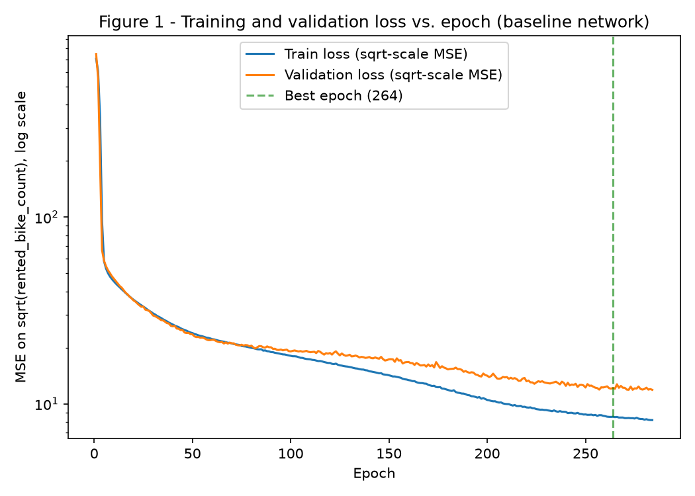
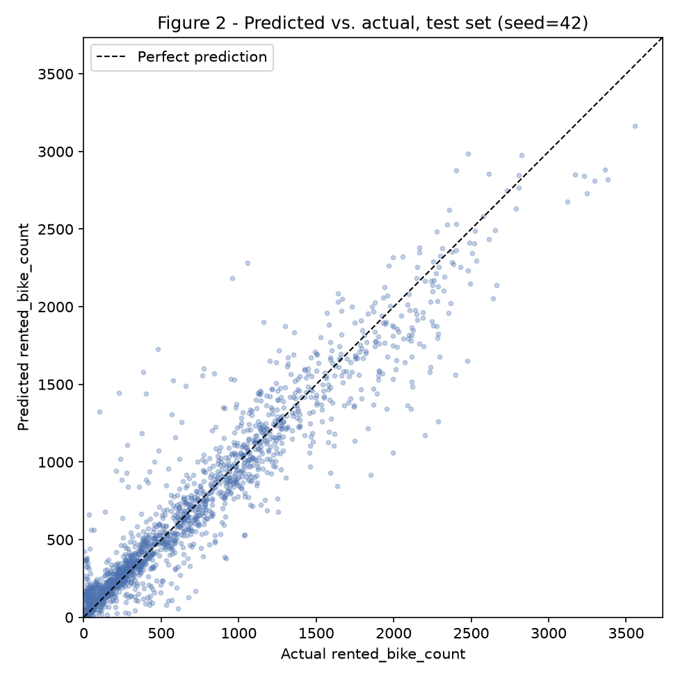
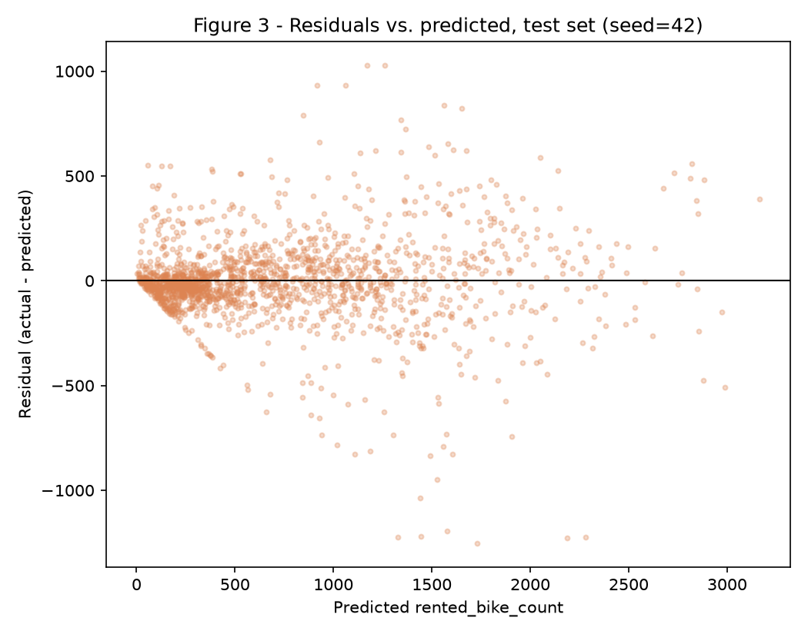

# Classification or Regression — Seoul Bike Sharing Demand (Regression)

Same dataset, task and train/test split as the [Regression EDA](../eda-regression/index.md), same seed (`random_state=42`) throughout. No model was trained in the EDA; this report picks up exactly where it left off: its fitted preprocessing `Pipeline` (`code/bike_preprocessing.py`) is imported unchanged, and every one of its risk-mitigation decisions (grouped-by-day split, `sqrt(y)` target transform, dropping `functioning_day`/`dew_point`) is carried forward rather than re-derived.

Five scripts under `code/`, run in order from a clean clone:

``` shell
python3 -m venv env
source ./env/bin/activate
python3 -m pip install -r requirements.txt --upgrade
python3 code/regression_baselines.py      # Step 1
python3 code/regression_training.py       # Steps 2-3, Figure 1
python3 code/regression_search.py         # Step 4
python3 code/regression_test_eval.py      # Step 5, Figures 2-3 (touches the test set)
python3 code/regression_error_analysis.py # Step 6
```

`code/regression_common.py` and `code/regression_model.py` hold what every script shares: the inner train/validation split and metrics, and the `MLPRegressor` + early-stopping training loop, respectively. All numbers below are also saved as JSON under `docs/projects/regression/outputs/`.

## 0. Starting Point

- **Pipeline:** `bike_preprocessing.build_preprocessor()`, fit on the training fold only — unchanged from the EDA (no grading corrections were available for this dataset at the time of writing).
- **Main metric:** **MAE**, in bikes/hour — the unit stakeholders (fleet rebalancing staff) reason in directly, and more robust than RMSE to the handful of very-high-demand outlier hours the EDA already flagged (Figure 1 of the EDA, skewness 1.125).
- **Success criterion, fixed before training:** *network test MAE at least 15% lower than the Ridge (linear) baseline's test MAE.* Ridge rather than the optional Random Forest baseline, because Ridge is the mandatory comparison point for "does a network learn something a linear model cannot" — Random Forest is reported too, for context, but clearing it was never the bar.
- **Internal validation split:** the EDA's 80/20 test split is untouched; its 80% training side is further split 1-in-6 (`StratifiedGroupKFold`, grouped by `date`, stratified by `season`, same recipe the EDA used for the outer split) into **5,609 training rows (235 days)** and **1,152 validation rows (47 days)** — never mixing hours from the same day across the split, per the EDA's risk #1.

## 1. Baselines

Three models, all trained on `sqrt(y)` via `TransformedTargetRegressor` (the same target transform the network uses below, so every comparison in this report is apples-to-apples), fit once on the inner training fold and evaluated on validation here:

``` python
--8<-- "code/regression_baselines.py"
```

| Baseline | Validation MAE | RMSE | R² | MAPE |
|---|---|---|---|---|
| Dummy (mean) | 538.94 | 716.41 | -0.099 | 287.04% |
| **Ridge** (linear, required) | 288.18 | 441.49 | 0.583 | 91.48% |
| Random Forest (optional) | 115.29 | 173.84 | 0.935 | 56.98% |

The dummy baseline already warns that this is not an easy dataset for a flat prediction (R² below 0): hour-to-hour demand swings by two orders of magnitude (2 to 3,556 bikes/hour), so "always guess the mean" is actively worse than guessing nothing. Random Forest comfortably beats Ridge, meaning the EDA's own conclusion — *demand is driven by temperature and hour, non-linearly, with season/precipitation/hour interactions* — already shows up as a large linear-vs-nonlinear gap before any network is involved.

## 2. The Network

``` python
--8<-- "code/regression_model.py"
```

Baseline architecture for Steps 2-3: **22 → 32 → 16 → 1**, `ReLU` hidden activations, 1 linear output unit (predicting `sqrt(rented_bike_count)`), **1,281 parameters**. Layer sizes are arguments to `MLPRegressor`, not hard-coded, so Step 4 can sweep them.

- **Widths:** 32 then 16 — halving each layer is a standard, mild taper; justified relative to data size below.
- **Depth:** 2 hidden layers — the EDA's PCA needed 7 components for 80% of the variance and flagged genuine season→precipitation→hour interactions (non-additive effects), which a single hidden layer can approximate only by brute-force width; two layers let the network compose "is it a commuter hour" with "is the weather good" more cheaply.
- **Activation:** `ReLU` — unlike `tanh` (used for the exercises), it does not saturate for the wide numeric range `StandardScaler` outputs still carry after the EDA's clipping, and is the standard default for tabular MLPs.
- **Initialization:** PyTorch's default (Kaiming-uniform for `Linear`, matched to `ReLU`) — no custom scheme was needed; training converges cleanly (Figure 1).
- **Output & loss:** 1 linear unit, `MSELoss` on `sqrt(rented_bike_count)` — not raw counts. The EDA measured the raw target's skewness at 1.125 and found `sqrt` (0.352) beats `log1p` (-0.749, overcorrects) as a variance-stabilizing transform (its own risk #2); squaring the prediction back (always ≥ 0, no clipping needed) is exactly `TransformedTargetRegressor`'s recipe, applied here by hand since the model is a `torch` network, not an sklearn estimator.
- **Parameters vs. training rows:** 1,281 parameters for 5,609 training rows — **4.38 rows per parameter**. Comfortable for a shallow MLP on standardized tabular features, and Step 4 checks whether a wider network (fewer rows/parameter) still generalizes once regularization is accounted for.

## 3. Training

``` python
--8<-- "code/regression_training.py"
```

- **Optimizer:** Adam — adaptive per-parameter learning rates handle the mix of one-hot (sparse, 0/1) and standardized continuous features without needing per-group learning rates, unlike plain SGD.
- **Learning rate:** `1e-3` (Adam's standard default) — the loss curve (Figure 1) drops smoothly with no oscillation, so this was not tuned further.
- **Batch size:** 128 — small enough for frequent updates on ~5,600 rows (44 batches/epoch), large enough to keep per-batch gradient noise reasonable.
- **Epochs:** capped at 300, **early stopping with patience 20** on validation RMSE (original bikes/hour scale, not the sqrt-scale training loss), best weights restored.



**Convergence and overfitting onset:** both curves fall together through about epoch 75 (log scale needed to see this — the initial drop from ~700 to ~20 in the first 5 epochs would otherwise hide everything after it). Past epoch ~75-100 the training loss keeps falling (8.18 at the final epoch) while validation plateaus and turns noisy (11.88 final, but its *minimum*, 12.17, was already reached at **epoch 264**) — a textbook, if modest, overfitting onset: the gap between train and validation loss is real but small, which is why early stopping alone (no explicit regularizer) turns out to be enough, as Step 4 confirms.

## 4. Regularization and Hyperparameters

Two regularization techniques (dropout, weight decay) plus batch normalization, against the Step 2-3 baseline, and two architecture widths — **8 configurations**, selected on validation:

``` python
--8<-- "code/regression_search.py"
```

| Configuration | Validation RMSE | MAE | R² | Best epoch |
|---|---|---|---|---|
| **Wider [64, 32] (no reg.)** | **167.30** | **109.69** | **0.940** | 194 |
| Baseline [32, 16] (no reg.) | 180.51 | 122.78 | 0.930 | 264 |
| + batchnorm | 185.97 | 122.79 | 0.926 | 101 |
| + weight decay 1e-4 | 189.84 | 130.45 | 0.923 | 264 |
| Wider [64, 32] + dropout 0.2 + weight decay 1e-4 | 223.27 | 139.97 | 0.893 | 207 |
| + batchnorm + dropout 0.2 | 242.14 | 148.40 | 0.874 | 122 |
| + dropout 0.2 | 266.78 | 167.64 | 0.848 | 195 |
| + dropout 0.2 + weight decay 1e-4 | 267.94 | 168.42 | 0.846 | 195 |

**The honest finding here is negative: every regularization technique tried made validation performance worse**, monotonically with its strength (dropout alone is the single worst change; stacking it with weight decay or batchnorm compounds the damage). This is consistent with Figure 1's small train/validation gap: the network was not overfitting badly enough for dropout's noise injection or weight decay's shrinkage to pay for itself — instead they handicap a network that has very little spare capacity to begin with (1,281-3,585 parameters) from fitting the genuine, non-noise signal the EDA documented (temperature/hour/season interactions). Batch normalization is the one technique that is nearly free here (122.79 vs. 122.78 MAE) — expected, since its main benefit (stabilizing activation scale across layers) matters far more for deeper networks than 2 hidden layers of already-standardized tabular inputs.

What *did* help was simply **more width**: `[64, 32]` (3,585 parameters, 1.56 rows/parameter) beats the narrower baseline with no regularization at all, confirming the network was previously under-capacity rather than over-capacity. **Chosen configuration: `[64, 32]`, no dropout, no weight decay, no batchnorm** — carried into Step 5.

## 5. Test Evaluation

The test set is used **exactly once**, here. The winning Step 4 configuration is retrained from **3 seeds** (`42, 43, 44`; only the network's own weight-init/shuffle seed varies — data, split and pipeline are identical across seeds) and compared against the baselines (refit once, deterministic) in a single table:

``` python
--8<-- "code/regression_test_eval.py"
```

| Model | Test MAE | RMSE | R² | MAPE |
|---|---|---|---|---|
| Dummy (mean) | 502.39 | 663.89 | -0.047 | 313.31% |
| Ridge (linear, required baseline) | 281.28 | 421.57 | 0.578 | 106.75% |
| Random Forest (optional baseline) | 133.77 | 219.04 | 0.886 | 53.15% |
| **Network (mean ± std, 3 seeds)** | **131.55 ± 3.07** | **210.89 ± 4.58** | **0.894 ± 0.005** | 64.35 ± 4.97% |





**Success criterion:** *network test MAE at least 15% lower than Ridge's.* Ridge: 281.28; network: 131.55 — a **53.2% reduction**. **Criterion met**, by a wide margin. For context only (not the success criterion, decided in Step 0 before the network ever saw the test set): the network's mean test MAE (131.55) also edges out the optional Random Forest baseline (133.77) — a genuinely strong result for a ~3,600-parameter network against an ensemble of 300 trees, though the two are close enough (within the network's own seed-to-seed std of 3.07) that this particular edge should not be over-read.

MAPE is reported but is the least trustworthy of the four metrics here: the target's minimum is 2 (never exactly 0, so it is computable), but 0.46% of all rows have `y < 10`, and a modest absolute error on one of those hours produces a huge *relative* error — exactly the kind of instability visible in its larger std (4.97 points) relative to its own mean, compared to MAE's tighter std (3.07 on a mean of 131.55).

Figure 2 shows the fit is tight and follows the diagonal well up to roughly 2,500 bikes/hour, with a slight tendency to under-predict the very highest-demand hours (the handful of points below the diagonal past 2,500). Figure 3's funnel shape — residual spread growing with predicted demand — is the same heteroscedasticity the EDA flagged (its Figure 7: winter's spread is much narrower than summer's); `sqrt(y)` reduces but does not eliminate it, since the variance-stabilizing property of `sqrt` is only exact for Poisson-like counts, and real demand is over-dispersed relative to that at high-traffic hours.

## 6. Error Analysis

``` python
--8<-- "code/regression_error_analysis.py"
```

**Error per subgroup** (test MAE, seed=42 model):

| Subgroup | n | MAE |
|---|---|---|
| **Holiday** | 72 | **193.49** |
| Summer | 456 | 178.35 |
| Rain | 147 | 146.27 |
| Spring | 432 | 139.78 |
| Autumn | 384 | 130.13 |
| Dry | 1,472 | 129.42 |
| No Holiday | 1,632 | 124.30 |
| Winter | 432 | 58.13 |
| Snow | 85 | 56.37 |

**Holiday hours are the single worst subgroup** (MAE 193.49, 56% worse than non-holiday's 124.30) — and the EDA's own risk #3 predicted exactly this: only 72 test hours are holidays (and 14 training *days*), too few for the network to learn holiday-specific demand patterns distinctly from an ordinary day. Season follows the same demand-level logic as the subgroup error, not an inverted one: **Summer (highest, most variable demand) is hardest to predict; Winter (lowest, flattest demand) is easiest** — an MLP's absolute error naturally tracks the scale of what it's predicting. The same pattern explains precipitation: snow (MAE 56.37) is the *easiest* precipitation regime despite being a bad-weather outlier, because snow suppresses demand so reliably (EDA: median 149 bikes/h) that predicting "low" is almost always right; rain (MAE 146.27) is harder because rain's effect on demand is less consistent (some rainy commuter hours still see meaningful ridership).

**Ten worst individual errors** are dominated by one failure mode: Summer and Spring daytime hours with ordinary ("dry", mild temperature) conditions where the network *over-predicted* by 950-1,250 bikes — e.g., actual 477 vs. predicted 1,729 at 19h, 22.3°C, Spring. The common thread is that these are hours where the *weather features alone* suggest high demand (favorable temperature, no precipitation, daytime/evening), but something the model cannot see — a specific one-off event, a local disruption, or just the natural variance day-to-day beyond what 12 months of data can characterize — suppressed actual ridership. Two of the ten worst errors run the other way (under-prediction on unusually high-demand hours), consistent with Figure 3's funnel: both failure directions grow with the scale of predicted demand, not with any single feature.

**Permutation importance** (RMSE increase when a feature is shuffled, mean over 20 permutations):

| Feature | RMSE increase |
|---|---|
| `hour_sin` | 392.16 |
| `hour_cos` | 320.54 |
| `temperature` | 238.08 |
| `seasons_Summer` | 191.65 |
| `solar_radiation` | 166.36 |
| `seasons_Autumn` | 127.63 |
| `humidity` | 105.49 |

**This matches the EDA almost exactly.** The EDA's bivariate analysis ranked `temperature` (Spearman 0.617) and `hour` (0.423) as the two strongest single-feature correlates of demand — here, the cyclical encoding splits hour into `hour_sin`/`hour_cos`, and *together* they dwarf every other feature's importance, with `temperature` a clear third. The EDA data's 4 informative structure (season → precipitation → hour trajectories, its Figure 15) also shows up directly: `seasons_Summer` and `solar_radiation` (a precipitation/weather proxy) are next in line. The network did not discover some orthogonal driver the EDA missed — it learned, with more nuance (non-linear, interacting), the same two or three drivers the univariate and bivariate analysis already pointed at.

## 7. Conclusion

**Was the network worthwhile?** Yes, relative to the mandatory bar: a 53.2% MAE reduction against Ridge is not a marginal win, and Figure 2/3 show the fit is genuinely tight, not an artifact of the metric. Relative to the optional Random Forest baseline, the picture is more honest: the network edges it out (131.55 vs. 133.77 MAE) but by less than the network's own seed-to-seed noise (± 3.07) — so "the network clearly beats the strongest baseline" would overstate this result. A fair summary is that the network *matches* a well-tuned Random Forest here, at a fraction of the parameter count, while requiring far more engineering (early stopping, an 8-configuration search, explicit target transform) to get there.

**Limitations:** (1) one year of data, so the model's validity for a different year's climate or a structurally different mix of holidays is untested — the EDA already flagged this. (2) Holiday hours remain the weakest subgroup by a wide margin, with only 72 test examples to judge that weakness on — not enough to be confident it generalizes past this particular test split. (3) The negative regularization result (Step 4) is itself a limitation of generality: it says this specific network, on this specific amount of data, did not need dropout/weight decay/batchnorm — not that regularization is never useful for this task; a larger network or less data would likely flip that conclusion.

**Affected stakeholders:** the bike-fleet operations team that would use these predictions for rebalancing. The error-analysis finding that Summer and holiday hours are the least reliable is directly actionable — operational buffers (extra bikes staged, more frequent rebalancing runs) should be largest exactly when the model is least trustworthy, not uniform across all hours.

**Future work:** multiple years of data to test the "only one year" limitation directly; an explicit holiday-type feature (which specific holiday, not just a binary flag) given how poorly the current 72-example signal generalizes; and testing whether the "regularization hurts" finding is specific to this network's small size by re-running the Step 4 search at the Random-Forest-matching capacity this network already reaches, to see whether regularization starts earning its keep once the network is made deliberately larger than necessary.

## Results summary

| # | Summary | Value |
|---|---|---|
| 1 | Dataset, task, target and main metric | UCI Seoul Bike Sharing Demand; regression; target `rented_bike_count` (bikes/hour); main metric MAE |
| 2 | Train · validation · test (rows) | 5,609 · 1,152 · 1,704 |
| 3 | Best baseline and its test metric | Random Forest (optional), test MAE 133.77 (required linear baseline, Ridge: test MAE 281.28) |
| 4 | Chosen network: layers × units, parameters, regularization | 2 hidden layers, 64×32 units (22→64→32→1), 3,585 parameters; no dropout/weight-decay/batchnorm (all tested, all hurt validation RMSE — Step 4) |
| 5 | Optimizer, learning rate, batch, stopping epoch | Adam, lr=1e-3, batch=128, stopped at epoch 194 (seed 42; patience 20 past the best epoch) |
| 6 | Network's main metric on test (mean ± std, 3 seeds) | MAE 131.55 ± 3.07 bikes/hour (RMSE 210.89 ± 4.58, R² 0.894 ± 0.005) |
| 7 | Success criterion met? | Yes — 53.2% lower test MAE than Ridge (criterion: ≥ 15%) |
| 8 | Subgroup with the largest error and its value | Holiday hours (n=72): MAE 193.49 bikes/hour, vs. 124.30 for non-holiday hours |
